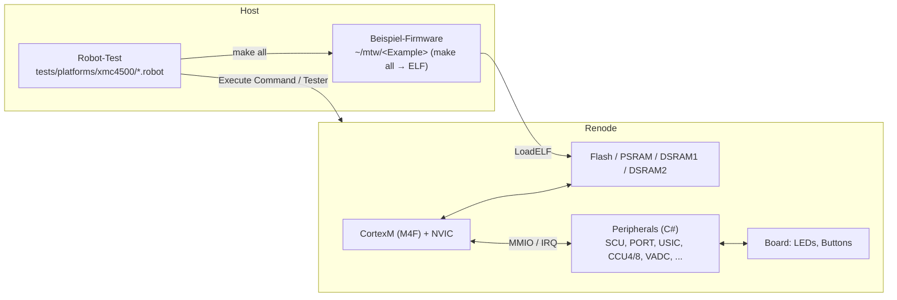
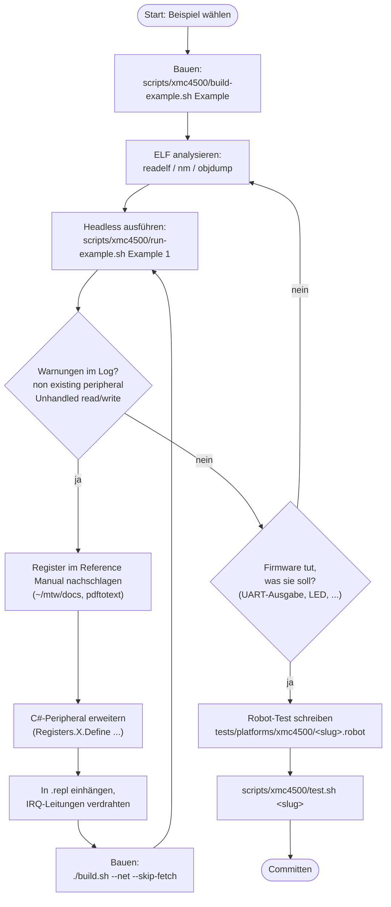
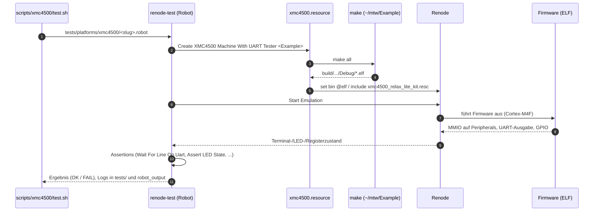

# Infineon XMC4500 / Relax Lite Kit in Renode

Diese Dokumentation beschreibt die Simulation des **XMC4500-F100x1024** auf dem **XMC4500 Relax Lite Kit** in Renode:
welche Komponenten (Peripherals) es gibt, wie man sie **manuell** entwickelt und prüft, und was die **automatischen Tests** tun.
Jede Komponente hat eine eigene Seite (Liste unten) mit Use-Case-, Klassen-, Sequenz- und Aktivitätsdiagrammen.

Diagramme sind in [Mermaid](https://mermaid.js.org) geschrieben und werden von GitHub direkt gerendert.

## Überblick



Dateien:

| Was | Wo |
|---|---|
| CPU/SoC-Beschreibung | `platforms/cpus/xmc4500.repl` |
| Board (LEDs, Buttons) | `platforms/boards/xmc4500_relax_lite_kit.repl` |
| Start-Skript | `scripts/single-node/xmc4500_relax_lite_kit.resc` |
| Peripheral-Modelle (C#) | `src/Infrastructure/src/Emulator/Peripherals/Peripherals/**/XMC4XXX_*.cs` (Submodul) |
| Robot-Tests | `tests/platforms/xmc4500/<komponente>.robot`, Ressource `xmc4500.resource` |
| Hilfsskripte | `scripts/xmc4500/*.sh` |
| Doku | `docs/xmc4500/` |
| Beispiel-Firmware (extern) | `~/mtw/<Example>` (`XMC_EXAMPLES_DIR`) |
| Handbücher (extern) | `~/mtw/docs/` (Reference Manual, Kit-Beschreibung) |

## Komponenten

| Komponente (slug) | Peripherals | Beispiele | Doku |
|---|---|---|---|
| `platform` | CPU, Speicher, SCU-Basis, USIC-UART (Hello World) | `UART_Printf` | [platform.md](platform.md) |
| `gpio-eru` | PORT, ERU (Event Request Unit) | `GPIO_Toggle`, `ERU_EXTINT`, `ERU_HIB_IO` | [gpio-eru.md](gpio-eru.md) |
| `scu-wdt-rtc` | SCU (Interrupts, Trap, Sleep), Brownout, WDT, RTC/Hibernate | `SCU_Sleep`, `Brownout_Detection`, `WDT_FEED`, `WDT_Prewarning`, `RTC_Alarm`, `Empty_XMC_App` | [scu-wdt-rtc.md](scu-wdt-rtc.md) |
| `usic` | USIC-Kanal: UART (+FIFO), SPI, I2C | `UART_Printf`, `UART_Transmit`, `UART_Transmit_Receive_FIFO_Interrupts`, `SPI_Master`, `SPI_EXTTRG_transmit`, `SPI_QSPI_Flash`, `I2C_Master_and_Slave` | [usic.md](usic.md) |
| `ccu4` | CCU4 (4 Slices je Einheit) | `CCU4_PWM`, `CCU4_Timer`, `CCU4_Timer_Concatenation` | [ccu4.md](ccu4.md) |
| `ccu8` | CCU8 | `CCU8_Capture`, `CCU8_PWM`, `CCU8_PWM_Complementary`, `CCU8_Timer`, `CCU8_Timer_Concatenation`, `CCU8_Timer_Synchronous_Start` | [ccu8.md](ccu8.md) |
| `vadc-dac` | VADC, DAC | `VADC_Background`, `VADC_EMUX`, `VADC_Queue`, `VADC_Scan`, `DAC_Sine_Wave`, `CCU8_TRIGGERED_VADC_MEASUREMENT` | [vadc-dac.md](vadc-dac.md) |
| `dma-fce` | GPDMA0/1, FCE (CRC) | `DMA_M2M`, `DMA_Ring_Buffer`, `DMA_GPIO`, `DMA_PWM`, `DMA_FCE`, `FCE_CRC`, `UART_DMA`, `SPI_DMA` | [dma-fce.md](dma-fce.md) |
| `can` | MultiCAN | `CAN_Loopback`, `CAN_Transmitter`, `CAN_Receiver` | [can.md](can.md) |
| `flash` | FLASH0/PMU (Programmieren, Löschen, Status) | `Flash_Program`, `Flash_EEPROM` | [flash.md](flash.md) |
| `posif` | POSIF | `POSIF_Hall`, `POSIF_QD` | [posif.md](posif.md) |
| `rtos-misc` | FreeRTOS-Lauf, sonstige | `FreeRTOS_Blinky`, `emUSB-Device_HID_Generic` (USB nur, wenn sinnvoll) | [rtos-misc.md](rtos-misc.md) |

## Manuell zum Ziel: Schritt für Schritt

Das Prinzip: **Die echte Firmware sagt, was modelliert werden muss.** Man lässt sie laufen, sieht, wo sie hängt oder
welche Register ins Leere greifen, modelliert genau das, und wiederholt.



1. **Beispiel bauen**: `scripts/xmc4500/build-example.sh GPIO_Toggle` (ruft `make all` in `$XMC_EXAMPLES_DIR/GPIO_Toggle` auf und gibt den ELF-Pfad aus). Alle Beispiele: `build-example.sh all`.
2. **ELF verstehen** (nie den ELF mit einem Texteditor/`Read` öffnen):
   - `arm-none-eabi-readelf -hlS app.elf` zeigt Einstiegspunkt und Segmente (Speicherlayout!).
   - `arm-none-eabi-objdump -d app.elf > dis.txt` und in `dis.txt` die abgefragten Funktionen lesen. Die Literal-Pools (`.word 0x4003xxxx`) verraten alle Peripherie-Basisadressen.
   - Pollschleifen erkennt man an `ldr … ; lsls rX,#n ; bpl/bmi`; `lsls #n` zeigt das gepollte Bit (`#31` → Bit 0, `#29` → Bit 2).
3. **Ausführen**: `scripts/xmc4500/run-example.sh GPIO_Toggle 3` startet Renode headless für 3 virtuelle Sekunden. UART-Ausgabe (`usic0ch0`) erscheint im Log. Zusätzliche Monitor-Befehle als dritter Parameter, z. B. `"logLevel -1 sysbus.nvic"` oder `"sysbus.cpu LogFunctionNames true"`.
4. **Log lesen**: `ReadDoubleWord from non existing peripheral at 0x…` → fehlendes Peripheral/Register. Steht dieselbe Adresse tausendfach im Log, ist das die Pollschleife, an der die Firmware hängt. `Unhandled read/write to offset …` mit `Tags:` → ein bisher nur getaggtes Bit wird wirklich benutzt.
5. **Register nachschlagen**: PDFs liegen in `~/mtw/docs`. Mit `pdftotext -layout infineon-xmc4500-rm-v1.6-2016-um-en.pdf rm.txt` durchsuchbar machen, dann `grep -n "Register Name" rm.txt`.
6. **Peripheral schreiben** (C#, Submodul `src/Infrastructure`): siehe Skill `.claude/skills/renode-add-mcu/SKILL.md`, Abschnitt "Writing peripherals". Neue Datei **in `Infrastructure.csproj` eintragen**.
7. **In die `.repl` einhängen** (`platforms/cpus/xmc4500.repl`), Interrupt-Leitungen mit `-> nvic@<irq>` verdrahten. IRQ-Nummern stehen im Reference Manual (Interrupt Node Assignment).
8. **Bauen**: `./build.sh --net --skip-fetch` (inkrementell ca. 1 Minute). Bei Fehlern `grep -E " error |Error\(s\)"`.
9. **Zustand beobachten**: Im Monitor (`./renode --console`) mit `sysbus ReadDoubleWord 0x…`, `sysbus.port1.led1 State`, `sysbus.cpu PC`, jeweils zwischen `emulation RunFor '0.1'`.
10. **Test schreiben und starten**: siehe unten.

## Was die Tests tun

Jede Komponente hat **eine** Robot-Datei `tests/platforms/xmc4500/<slug>.robot`. Ein Test-Case entspricht einem Beispielprogramm
(oder einem Teilverhalten davon). Gemeinsamer Ablauf:



Typische Assertions:

| Was prüfen | Keyword |
|---|---|
| Text auf der UART | `Create Terminal Tester sysbus.usic0ch0` → `Wait For Line On Uart  text  timeout=5` |
| LED-Zustand | `Create LED Tester sysbus.port1.led1` → `Assert LED State  true  timeout=2`, `Assert LED Is Blinking  testDuration=…  onDuration=…  offDuration=…  tolerance=…` |
| Registerwert | `Execute Command  sysbus ReadDoubleWord 0x…` und Vergleich |
| Symbolwert der Firmware | `Execute Command  sysbus ReadDoubleWord <addr aus nm>` |
| Eingang stimulieren | `Execute Command  sysbus.port1.button1 PressAndRelease` |

Einzelne Tests starten:

```bash
scripts/xmc4500/test.sh gpio-eru            # eine Komponente
scripts/xmc4500/test.sh usic -t "UART Printf"   # nur ein Test-Case (weitere Argumente gehen an renode-test)
scripts/xmc4500/test.sh all                 # alle
scripts/xmc4500/test.sh list                # welche Komponenten haben einen Test
```

Voraussetzungen: gebautes Renode (`./build.sh --net`), Python-venv `~/.venvs/renode-xmc` (Robot Framework, psutil, …; Pfad per `XMC_VENV` änderbar),
Beispiele in `~/mtw` (Pfad per `XMC_EXAMPLES_DIR` änderbar), `arm-none-eabi-gcc` und `make`.

## Konventionen (für Entwickler und Agents)

- **Ein Branch und ein Arbeitsverzeichnis je Komponente**: `scripts/xmc4500/new-workspace.sh <slug>` klont das Verzeichnis (inkl. Build-Cache) nach `../renode-xmc-<slug>` mit Branch `xmc4500-<slug>` (Repo und Submodul). Zusammenführen mit `scripts/xmc4500/merge-workspace.sh <slug>` im Hauptverzeichnis.
- **C#-Klassen** heißen `XMC4XXX_<Name>` (z. B. `XMC4XXX_CCU4`), eine Datei je Klasse, im passenden Unterordner von `Peripherals/` (Timers, GPIOPort, UART, SPI, I2C, Miscellaneous, DMA, CAN, ADC, …). Lizenz-Header wie in den Nachbardateien.
- **Registerlayouts aus dem Reference Manual**, nicht aus dem Gedächtnis. Im Quelltext-Kommentar das Kapitel nennen. Unbekannte/ungenutzte Bits mit `WithTaggedFlag/WithTag`, benutzte Bits implementieren.
- **Status sofort, Timing grob**: Hardwareabläufe, die Firmware nur abwartet (Lock, Busy, Done), werden sofort erledigt. Zeitverhalten (Timer, PWM-Perioden, Baudrate) dort exakt, wo ein Test es beobachtet.
- **Interrupts**: Service-Request-Leitungen als `Connections`/`GPIO` ausführen und in `xmc4500.repl` mit `-> nvic@N` verdrahten (Nummern aus dem Reference Manual).
- **Gemeinsame Dateien** (`xmc4500.repl`, `Infrastructure.csproj`) nur durch kleine, additive Änderungen anfassen (eigener Block mit Kommentarzeile, keine Umformatierung), damit Merges konfliktarm bleiben. `tests/tests.yaml` pflegt der Integrator nach dem Merge.
- **Tests**: `tests/platforms/xmc4500/<slug>.robot`, Kopf mit `Resource    ${CURDIR}/xmc4500.resource`. Ein Test-Case je Beispielprogramm; eindeutige, beobachtbare Kriterien (UART-Text, LED, Registerwert), keine bloßen Sleeps.
- **Doku**: `docs/xmc4500/<slug>.md` nach [TEMPLATE.md](TEMPLATE.md).
- **Commits**: Submodul zuerst, dann Hauptrepo (Pointer + Dateien); kleine, thematische Commits mit englischer Message im Stil der bestehenden. Kein Push ohne Auftrag. Die Hersteller-ELFs nicht committen.

## Was bewusst nicht (oder nur grob) modelliert ist

- Genaues Zeitverhalten von Taktbaum und PLL (Status wird sofort gesetzt, Frequenzen kommen aus der Firmware-Rechnung).
- Analoges Verhalten (ADC-Messwerte werden vom Test vorgegeben, DAC-Ausgabe wird nur protokolliert).
- Debugger/Boot-ROM (Vektortabelle wird per `.resc` gesetzt).
- Polarität von LEDs/Buttons: aktiv-high angenommen, in der Kit-Dokumentation nicht angegeben.
