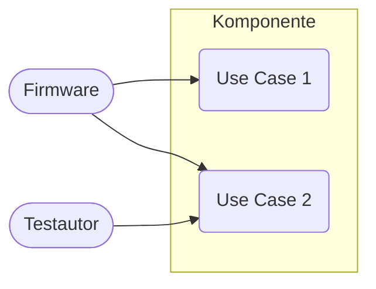
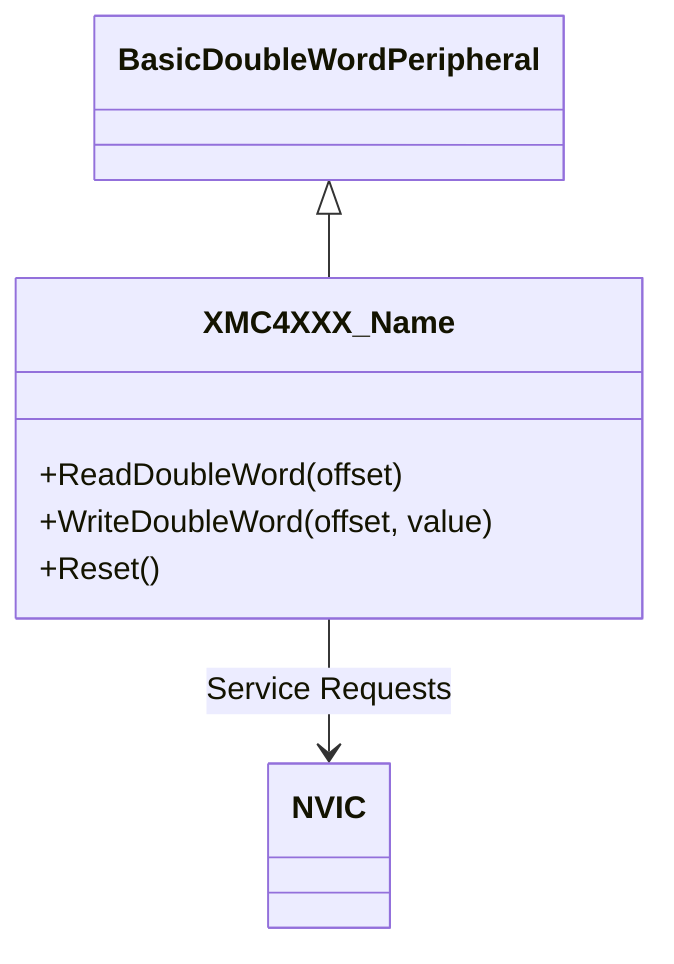
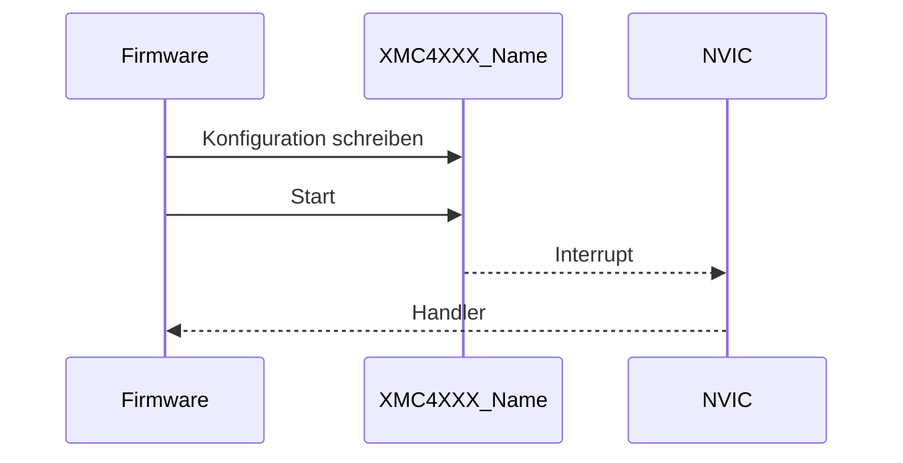
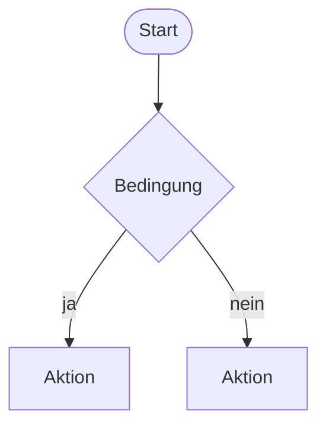

# <Komponente> (`<slug>`)

> Kurzbeschreibung in einem Satz: welches Peripheral der XMC4500 wird nachgebildet, für welche Beispiele.

Referenz: Reference Manual v1.6, Kapitel <n> "<Titel>" (Seiten …). Beispiele: `<Example1>`, `<Example2>`.

## 1. Use Cases

Wer benutzt die Komponente wozu? (Firmware-Entwickler, Testautor, Simulation-Nutzer.)



## 2. Aufbau

Klassen, Register, Verdrahtung (Adressen, IRQs, Verbindungen zu anderen Peripherals).



Registerübersicht (nur modellierte Register; Spalten: Offset, Name, Verhalten im Modell):

| Offset | Register | Verhalten |
|---|---|---|

Einbindung in `platforms/cpus/xmc4500.repl`:

```
name: Type.XMC4XXX_Name @ sysbus <addr>
    -> nvic@<irq>
```

## 3. Verhalten

Sequenzdiagramm eines typischen Ablaufs zwischen Firmware, Peripheral und Umgebung.



Aktivitätsdiagramm der inneren Logik (z. B. Zustandswechsel, Flags):



## 4. Vereinfachungen und bekannte Lücken

- …

## 5. Manuell nachvollziehen

Konkrete Befehle (Bauen, Ausführen, Beobachten), die zum Ziel führen:

```bash
scripts/xmc4500/run-example.sh <Example> 2
```

Erwartete Ausgabe/Beobachtung: …

## 6. Tests

Datei: `tests/platforms/xmc4500/<slug>.robot`, Start: `scripts/xmc4500/test.sh <slug>`.

| Test-Case | Beispiel | Prüft |
|---|---|---|
