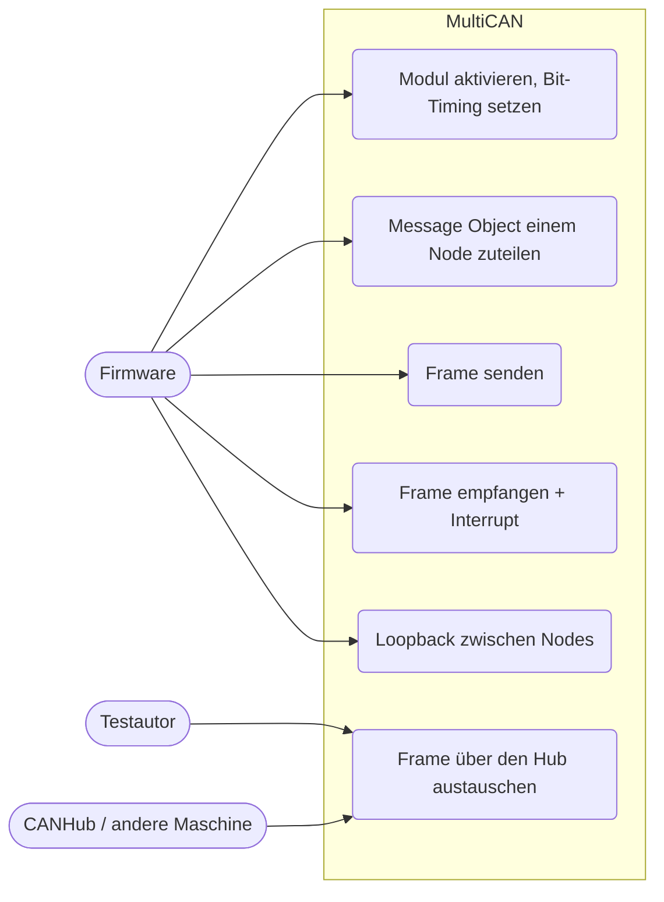
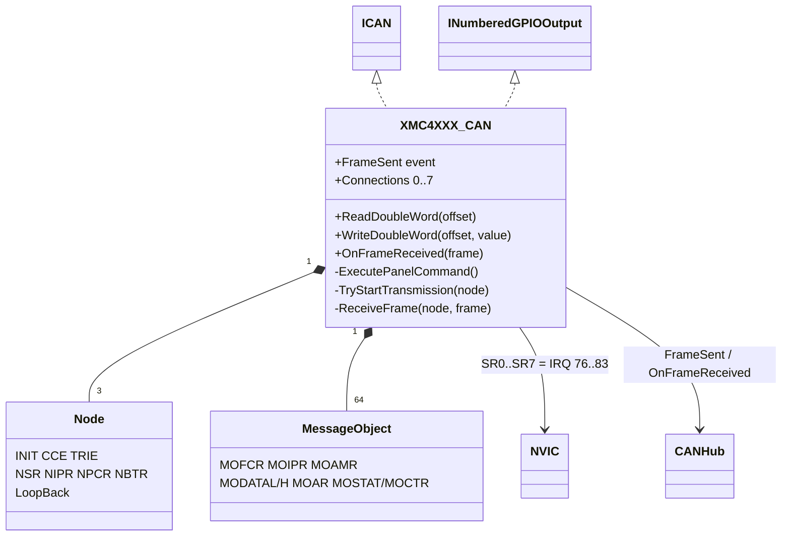
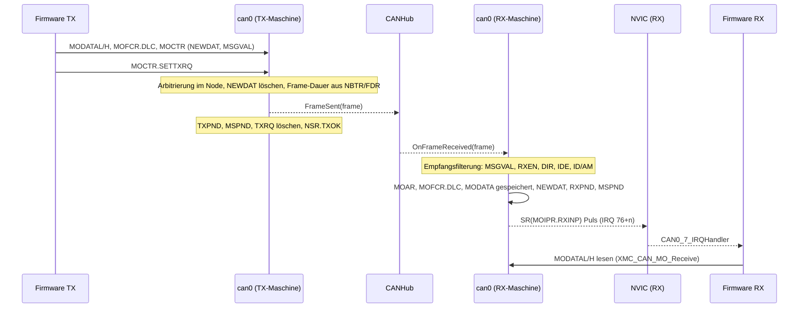
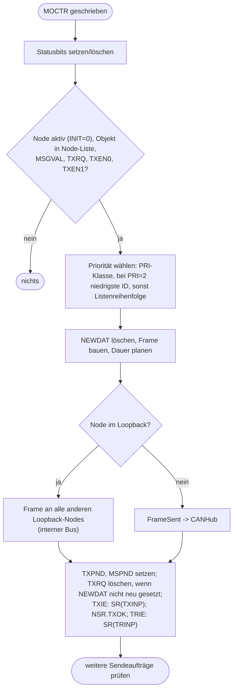

# MultiCAN (`can`)

> Bildet das MultiCAN-Modul (CAN0) des XMC4500 nach: Listen/Panel, drei Nodes, 64 Message Objects, Loopback über den internen CAN-Bus und Anbindung an einen Renode-`CANHub`, damit zwei Maschinen über CAN kommunizieren können.

Referenz: Reference Manual v1.6, Kapitel 18 "Controller Area Network Controller (MultiCAN)" (Registerbeschreibung 18.7, Listen 18.3.4, Loop-Back 18.3.5.2, Filterung 18.3.6, Interrupts 18.3.7 und 18.4). Beispiele: `CAN_Loopback`, `CAN_Transmitter`, `CAN_Receiver`.

## 1. Use Cases



## 2. Aufbau



Registerübersicht (Offsets relativ zu `0x48014000`; die Message Objects liegen bei `0x1000 + n*0x20`):

| Offset | Register | Verhalten im Modell |
|---|---|---|
| 0x000 | CLC | `DISS` folgt `DISR` sofort |
| 0x008 | ID | konstant `0x002BC001` |
| 0x00C | FDR | `STEP`, `DM` werden gespeichert und für die Bitzeit benutzt, übrige Bits getaggt |
| 0x100 + 4i | LIST0..7 | aus den Listen berechnet (BEGIN, END, SIZE, EMPTY) |
| 0x140 + 4k | MSPNDk | Pending-Bits bei Rx/Tx-Event; Schreiben von 0 löscht |
| 0x180 + 4k | MSIDk | niedrigstes gesetztes Bit von `MSPNDk & MSIMASK`, sonst 0x20 |
| 0x1C0 | MSIMASK | gespeichert |
| 0x1C4 | PANCTR | Panel-Befehle 1..7 (Init, Static/Dynamic Allocate, Insert Before/Behind) laufen sofort; `BUSY` ist immer 0 |
| 0x1C8 | MCR | `MPSEL` (0 und 0xF bestimmen die Pending-Bit-Position) |
| 0x1CC | MITR | Schreiben von 1 an `IT[n]` löst SRn aus |
| 0x200 + 0x100 n | NCR | `INIT` (Reset 1), `TRIE`, `LECIE`, `ALIE`, `CANDIS` (setzt `INIT`), `CCE`, `CALM` (nur bei `INIT`) |
| 0x204 + 0x100 n | NSR | `TXOK`, `RXOK`, `ALERT`, `LLE`, `LOE` (Schreiben von 0 löscht), `LEC` |
| 0x208 + 0x100 n | NIPR | `ALINP`, `LECINP`, `TRINP`, `CFCINP` |
| 0x20C + 0x100 n | NPCR | `LBM` (Loopback), `RXSEL`; nur bei `CCE` schreibbar |
| 0x210 + 0x100 n | NBTR | nur bei `CCE` schreibbar; bestimmt die Frame-Dauer |
| 0x214, 0x218 + 0x100 n | NECNT, NFCR | nur gespeichert |
| 0x1000 + 0x20 n + 0x00 | MOFCR | `RXIE`, `TXIE`, `SDT`, `DLC` benutzt |
| + 0x04 | MOFGPR | gespeichert (FIFO/Gateway nicht modelliert) |
| + 0x08 | MOIPR | `RXINP`, `TXINP`, `MPN` benutzt |
| + 0x0C | MOAMR | `AM`, `MIDE` benutzt |
| + 0x10, 0x14 | MODATAL, MODATAH | Nutzdaten |
| + 0x18 | MOAR | `ID`, `IDE`, `PRI` benutzt; bei Empfang mit dem Frame überschrieben |
| + 0x1C | MOSTAT (lesen) / MOCTR (schreiben) | Set/Reset-Paare (beide gesetzt = toggeln); lesen liefert Statusbits, LIST, PPREV, PNEXT |

Einbindung in `platforms/cpus/xmc4500.repl`:

```
can0: CAN.XMC4XXX_CAN @ sysbus 0x48014000
    peripheralClockFrequency: 72000000
    [0-7] -> nvic@[76-83]
```

Die acht Service-Request-Leitungen SR0..SR7 sind `CAN0_0_IRQn..CAN0_7_IRQn` (76..83, laut `XMC4500.h`). Sie werden als Puls (Set true, Set false) ausgelöst, weil ein CAN-Interrupt ein Ereignis ist: Die Beispiele löschen `RXPND` nie, ein Pegel würde sonst endlos neu auslösen.

## 3. Verhalten

Senden und Empfangen zwischen zwei Maschinen über einen `CANHub` (`CAN_Transmitter` / `CAN_Receiver`):



Ablauf eines Message Objects im Modell:



## 4. Vereinfachungen und bekannte Lücken

- Bit-Timing grob: Die Frame-Dauer ergibt sich aus FDR (`STEP`, `DM`), NBTR und einer angenommenen Peripherietaktfrequenz (`peripheralClockFrequency`, Standard 72 MHz) mit 47 bzw. 67 Bit plus Datenbits; Bit-Stuffing, Arbitrierungsverlust, Sample-Point und Resynchronisation fehlen.
- Jede Übertragung gilt als bestätigt (ACK): kein Ack-Error, keine Fehlerzähler, kein Error-Passive/Bus-Off, `LEC` nur per Software.
- Alle Nodes, die nicht im Loopback sind, teilen sich den einen externen Bus (eine `ICAN`-Schnittstelle pro Modul); `NPCR.RXSEL` und die Pinverschaltung sind ohne Wirkung. Nodes im Loopback hören nur den internen Bus, nie den Hub.
- Ein Node empfängt seinen eigenen gesendeten Frame nicht (nur andere Nodes). Im Loopback-Beispiel liegen Sender und Empfänger auf Node 0 und Node 1.
- Nicht modelliert: FIFOs (`MMC`≠0), Gateway, `STT`, Frame Counter/Analysefunktionen, `FRREN`/`RMM`, CAN-FD, Suspend, SCU-Reset/Clock-Gating des Moduls. Remote-Frames werden unterstützt (Empfang setzt `TXRQ` des Sendeobjekts, ein Empfangsobjekt mit `TXRQ` sendet einen Remote-Frame).
- Die Listeninitialisierung nach Reset ist sofort fertig (`PANCTR.BUSY` = 0).
- Interrupt-Pointer ≥ 8 (SR8..15) haben keine Leitung und werden verworfen.

## 5. Manuell nachvollziehen

```bash
scripts/xmc4500/build-example.sh CAN_Loopback
scripts/xmc4500/run-example.sh CAN_Loopback 3
# erwartet: "Received CAN frame", "Data1: 10000000", "Data2: 20000000" ... jede virtuelle Sekunde mit hochgezählten Daten
```

Zwei Maschinen im Monitor (`./renode --console`):

```
emulation CreateCANHub "hub"
mach create "tx"
machine LoadPlatformDescription @platforms/boards/xmc4500_relax_lite_kit.repl
sysbus LoadELF @/home/<user>/mtw/CAN_Transmitter/build/APP_KIT_XMC45_RELAX_V1/Debug/mtb-example-xmc-can-transmitter.elf
cpu VectorTableOffset 0x08000000
connector Connect sysbus.can0 hub
mach create "rx"
machine LoadPlatformDescription @platforms/boards/xmc4500_relax_lite_kit.repl
sysbus LoadELF @/home/<user>/mtw/CAN_Receiver/build/APP_KIT_XMC45_RELAX_V1/Debug/mtb-example-xmc-can-receiver.elf
cpu VectorTableOffset 0x08000000
connector Connect sysbus.can0 hub
showAnalyzer sysbus.usic0ch0
emulation SetGlobalQuantum "0.0001"
start
mach set "tx"
sysbus.port1.button1 Press
```

Erwartung: Die UART der `rx`-Maschine zeigt `Button State: 0`, nach dem Tastendruck `Button State: 1` und LED2 (`sysbus.port1.led2`) der Empfängermaschine leuchtet; nach `Release` wieder `Button State: 0`.

## 6. Tests

Datei: `tests/platforms/xmc4500/can.robot`, Start: `scripts/xmc4500/test.sh can`.

| Test-Case | Beispiel | Prüft |
|---|---|---|
| Should Receive Looped Back Frames Between Two Nodes With Incrementing Data | `CAN_Loopback` | Panel/Listen, Loopback-Bus, Empfangsfilter, Interrupt SR7 (IRQ 83), Daten `10000000/20000000`, danach `...01` |
| Should Transmit Frames Periodically And Toggle The LED | `CAN_Transmitter` (einzeln) | LED1 wechselt alle 100 ms, `MOSTAT.TXPND` des Sendeobjekts gesetzt |
| Should Follow The Transmitter Button State On The Receiver LED | `CAN_Transmitter` + `CAN_Receiver` | zwei Maschinen über `CANHub`: `Button State: 0/1/0` auf der Empfänger-UART, LED2 der Empfängermaschine folgt dem Taster der Sendermaschine |
