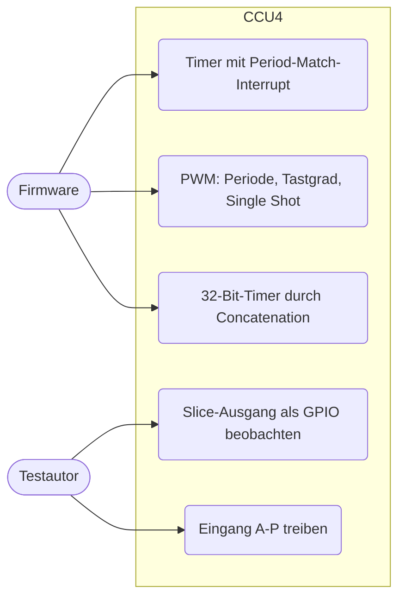
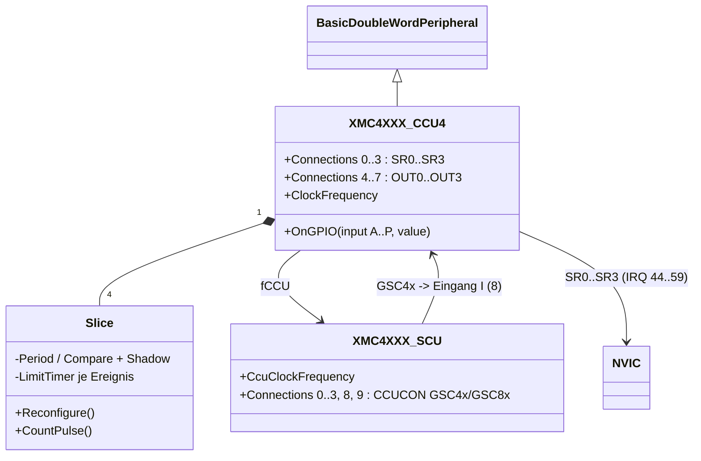
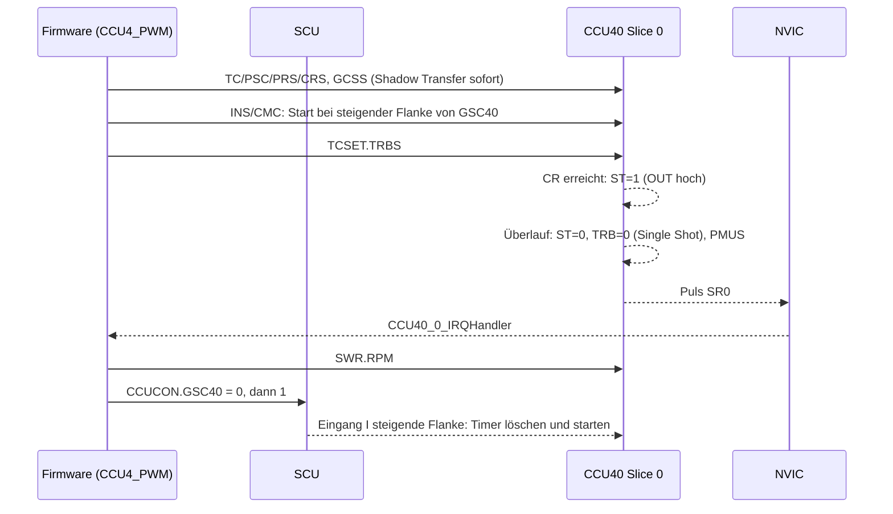
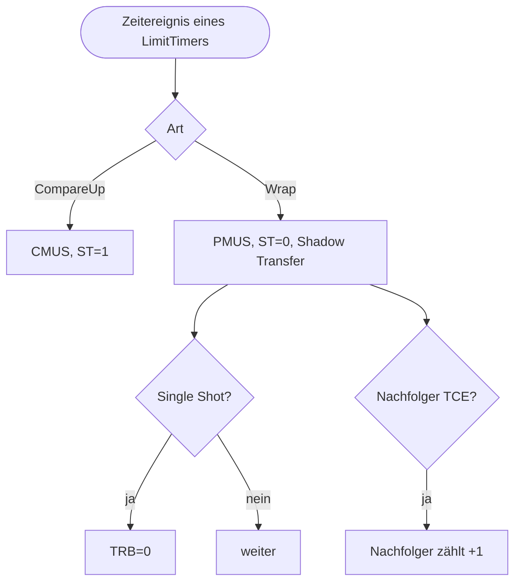

# Capture/Compare Unit 4 (`ccu4`)

> Nachbildung der vier CCU4-Einheiten (CCU40..CCU43, je vier Slices) des XMC4500 im Compare-Betrieb (Timer, PWM, Concatenation) für `CCU4_PWM`, `CCU4_Timer` und `CCU4_Timer_Concatenation`.

Referenz: Reference Manual v1.6, Kapitel 22 "Capture/Compare Unit 4 (CCU4)"; SCU-Register CCUCON/CCUCLKCR. Beispiele: `CCU4_PWM`, `CCU4_Timer`, `CCU4_Timer_Concatenation`.

## 1. Use Cases



## 2. Aufbau



Globale Register (Offset in der Einheit): GCTRL 0x00, GSTAT 0x04 (Reset 0xF, alle Slices idle), GIDLS 0x08, GIDLC 0x0C, GCSS 0x10, GCSC 0x14, GCST 0x18, ECRD 0x50, MIDR 0x80.
Slice-Register `0x100*(y+1) + off`: INS 0x00, CMC 0x04, TCST 0x08, TCSET 0x0C, TCCLR 0x10, TC 0x14, PSL 0x18, DIT/DITS 0x1C/0x20, PSC 0x24, FPC/FPCS 0x28/0x2C, PR/PRS 0x30/0x34, CR/CRS 0x38/0x3C, TIMER 0x70, CV0..3 0x74.. (lesen 0), INTS 0xA0, INTE 0xA4, SRS 0xA8, SWS 0xAC, SWR 0xB0.

| Funktion | Verhalten im Modell |
|---|---|
| Takt | fTCLK = fCCU / 2^PSIV; fCCU = SCU `CcuClockFrequency` (fSYS >> CCUDIV), Fallback-Konstruktorparameter `clockFrequency` |
| Zählen | Slice zählt nur bei TRB=1, nicht idle (GIDLC.CSxI) und laufendem Prescaler (GIDLC.SPRB) |
| Edge aligned | Periode PR+1 Takte; Compare-Match bei TIMER=CR setzt ST, Period-Match beim Überlauf löscht ST (Tastgrad = 1 - CR/(PR+1)); CR=0: ST immer aktiv |
| Center aligned | Periode 2*(PR+1); Period-Match, One-Match, Compare up/down, CDIR |
| Single Shot | TRB wird beim Ende der Periode gelöscht |
| Shadow Transfer | GCSS.SxSE setzt Anforderung; Übernahme von PRS/CRS/PSL beim Überlauf (center: bei Period-/One-Match), sofort bei gestopptem Timer; TC.CLST beim Löschen |
| Interrupts | INTS-Flags immer; bei INTE und Routing SRS wird auf SR0..3 ein Puls ausgegeben; SWS/SWR |
| Ausgang | OUT = ST xor PSL (Connections 4..7) |
| Externe Funktionen | Eingangswahl EVxIS, Flanke EVxEM, Pegel EVxLM; Start (STRM: Start / Löschen+Start), Stop (ENDM), Count (CNTS), Gating (GATES) |
| Concatenation | CMC.TCE: der Überlauf des Vorgänger-Slices zählt den Slice um eins weiter (32/48/64 Bit) |
| Eingänge | `OnGPIO(n)`: n = Eingang A..P (0..15), für alle Slices der Einheit gleich; 8 = SCU GSC4x, 12..15 = ST0..ST3 |

Einbindung in `platforms/cpus/xmc4500.repl`:

```
ccu40: Timers.XMC4XXX_CCU4 @ sysbus 0x4000C000
    scu: scu
    [0-3] -> nvic@[44-47]
scu:
    0 -> ccu40@8
```
(CCU41 0x40010000 -> 48..51, CCU42 0x40014000 -> 52..55, CCU43 0x48004000 -> 56..59.)

Änderung an `XMC4XXX_SCU`: Register CCUCON (0x4C) mit `Connections` (Bitnummer; 0-3 GSC40-43, 8-9 GSC80-81) und Property `CcuClockFrequency`.

## 3. Verhalten





Je Slice gibt es einen periodischen `LimitTimer` pro Ereignis (Compare, Wrap, bei center aligned zusätzlich Period/One/Compare-down), Laufzeit = (PR+1)*2^PSIV Ticks von fCCU; erst bei Konfigurationsänderung (Start, Stop, Shadow Transfer mit neuen Werten, Gating) werden sie neu programmiert. Extern getaktete Slices (Count, Concatenation) zählen die Position von Hand.

## 4. Vereinfachungen und bekannte Lücken

- Nicht modelliert: Capture-Modus, externes Laden, Up/Down-Eingang, TRAP, Modulation, Status-Override, Dither, Floating Prescaler (Register werden gespeichert), Eingangsfilter, Multi-Channel-Eingang MCSS, Suspend.
- ST wird ohne die Verzögerung von einem Takt gesetzt/gelöscht (PWM-Dauer stimmt: PR+1-CR Takte), Period-Match-Flag und Überlauf fallen zusammen.
- Alle Eingänge A..P sind für alle Slices einer Einheit gleich; die Port-Alternativfunktionen (Pin -> Eingang/Ausgang) sind nicht verdrahtet. In Tests werden die Ausgänge über eine Test-`.repl` an eine `Miscellaneous.LED` gehängt.
- Der Prescaler-Zähler hat keine Phase: ein Slice startet immer mit einem frischen Teilertakt.
- Last: die Concatenation-Firmware erzeugt ~2 Mio. Ereignisse je virtueller Sekunde; die Simulation läuft dort ca. 50x langsamer als Echtzeit.

## 5. Manuell nachvollziehen

```bash
scripts/xmc4500/run-example.sh CCU4_Timer 0 "emulation RunFor '1.5'; sysbus.port1.led1 State; emulation RunFor '1'; sysbus.port1.led1 State"
# True, danach False (LED1 wechselt jede Sekunde)
scripts/xmc4500/run-example.sh CCU4_Timer_Concatenation 0 "emulation RunFor '0.2'; sysbus.ccu40 ReadDoubleWord 0x270"
# 0x3: High-Slice des 32-Bit-Zählers (1 MHz-Takt, 200000 Zählschritte)
```

## 6. Tests

Datei: `tests/platforms/xmc4500/ccu4.robot`, Start: `scripts/xmc4500/test.sh ccu4`.

| Test-Case | Beispiel | Prüft |
|---|---|---|
| Should Generate 2 Hz PWM With 50 Percent Duty Cycle | `CCU4_PWM` | Ausgang OUT0 (Test-LED): 0,25 s an / 0,25 s aus; Neustart über SCU-GSC40 im Interrupt |
| Should Toggle LED Once Per Second From Period Match Interrupt | `CCU4_Timer` | LED1 1 s an / 1 s aus (Prescaler 2048, 72 MHz, Period-Match-IRQ 44) |
| Should Count Microseconds With Concatenated 32 Bit Timer | `CCU4_Timer_Concatenation` | LED1 mit 73/72 s Halbperiode, Zählerwert aus High/Low-Slice |
