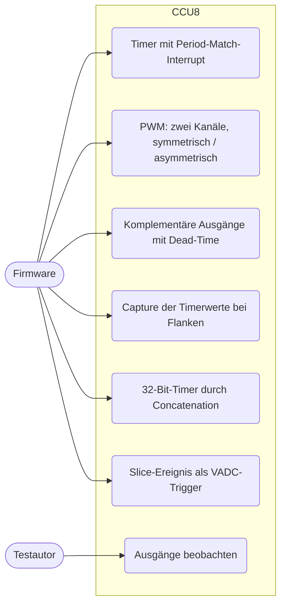
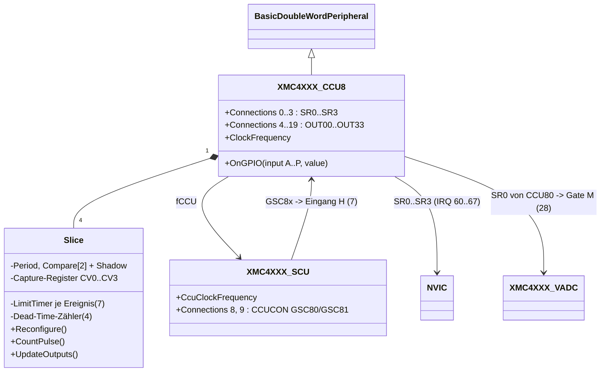
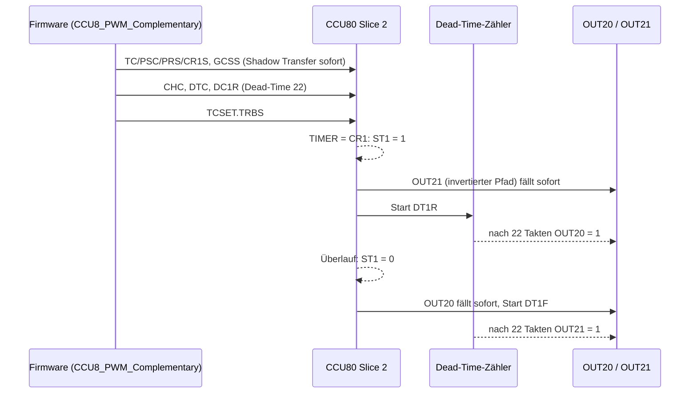
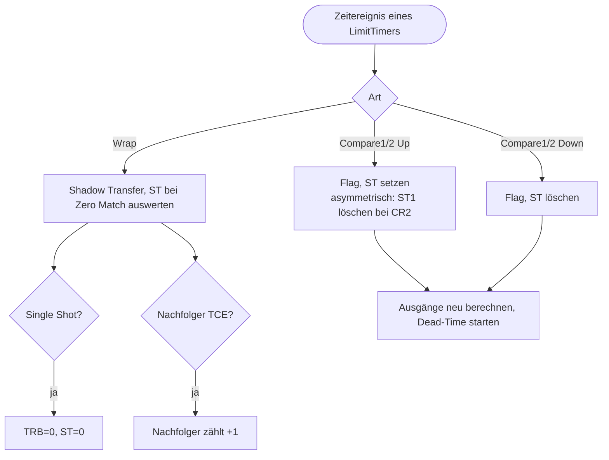

# Capture/Compare Unit 8 (`ccu8`)

> Nachbildung der zwei CCU8-Einheiten (CCU80, CCU81, je vier Slices mit zwei Vergleichskanälen) des XMC4500: Compare-Betrieb mit komplementären Ausgängen und Dead-Time, Capture-Modus, Timer-Concatenation und Start über SCU-/Eingangssignale, für die Beispiele `CCU8_*`.

Referenz: Reference Manual v1.6, Kapitel 23 "Capture/Compare Unit 8 (CCU8)"; SCU-Register CCUCON/CCUCLKCR. Beispiele: `CCU8_Capture`, `CCU8_PWM`, `CCU8_PWM_Complementary`, `CCU8_Timer`, `CCU8_Timer_Concatenation`, `CCU8_Timer_Synchronous_Start`, `CCU8_TRIGGERED_VADC_MEASUREMENT`.

## 1. Use Cases



## 2. Aufbau



`XMC4XXX_CCU8` ist eine eigene Klasse (kein gemeinsamer Unterbau mit `XMC4XXX_CCU4`): die Slice-Logik ist weitgehend dieselbe, aber Kanäle, Ausgangsstufe, `SRS`/`INTS`-Layout und Capture unterscheiden sich so stark, dass eine gemeinsame Basis mehr Sonderfälle als Code sparen würde. Die Teile, die aus CCU4 übernommen sind (Positions-/LimitTimer-Schema, externe Funktionen, Concatenation), sind kopiert.

Globale Register: GCTRL 0x00, GSTAT 0x04 (Reset 0xF), GIDLS 0x08, GIDLC 0x0C, GCSS 0x10, GCSC 0x14, GCST 0x18 (Shadow-Status und ST1/ST2 aller Slices), GPCHK 0x1C (nur gespeichert), ECRD 0x50 (0), MIDR 0x80.
Slice-Register `0x100*(y+1) + off`: INS 0x00, CMC 0x04, TCST 0x08 (TRB, CDIR, DTR1/2), TCSET 0x0C, TCCLR 0x10 (TRBC, TCC, DTC1C/2C), TC 0x14, PSL 0x18, PSC 0x24, PR/PRS 0x30/0x34, CR1/CR1S 0x38/0x3C, CR2/CR2S 0x40/0x44, CHC 0x48, DTC 0x4C, DC1R 0x50, DC2R 0x54, TIMER 0x70, CV0..3 0x74.., INTS 0xA0, INTE 0xA4, SRS 0xA8, SWS 0xAC, SWR 0xB0.

| Funktion | Verhalten im Modell |
|---|---|
| Takt | fTCLK = fCCU / 2^PSIV; fCCU = SCU `CcuClockFrequency` |
| Zählen | Slice zählt nur bei TRB=1, nicht idle (GIDLC.CSxI) und laufendem Prescaler (GIDLC.SPRB) |
| Edge aligned | Periode PR+1 Takte; ST1/ST2 werden bei TIMER=CR1/CR2 gesetzt und beim Überlauf gelöscht (Tastgrad 1 - CR/(PR+1)); CR=0: ST von Beginn an aktiv, CR>PR: nie aktiv |
| Center aligned | Periode 2*(PR+1); Period-/One-Match, Compare up/down je Kanal, CDIR |
| Asymmetrisch (CHC.ASE) | ST1 wird bei CR1 gesetzt und bei CR2 gelöscht (center aligned: bei Down-Match von CR2); Ausgänge von Kanal 2 passiv |
| Statusausgang (TC.STOS) | ST1, ST2 oder ST1 und ST2; wirkt als Eingang 12..15 der Slices der Einheit |
| Ausgänge | CHC.OCS1-4 wählen ST-/invertierten ST-Pfad je OUTs0..OUTs3; Pegel = Pfad xor Passivpegel (PSL); ein idle Slice hält die Ausgänge passiv |
| Dead-Time | je Kanal DTE, je Pfad DCEN1-4, Takt fTCLK/2^DTCC, DT*R (steigend) und DT*F (fallend) aus DC1R/DC2R; der verzögerte Pfad bleibt für die Dauer passiv, ein neuer Übergang startet neu |
| Shadow Transfer | GCSS.SxSE; Übernahme von PRS/CR1S/CR2S/PSL beim Überlauf (center: bei Period-/One-Match), sofort bei gestopptem Timer |
| Interrupts | INTS-Flags immer; bei INTE und SRS-Routing wird auf SR0..3 ein Puls ausgegeben; SWS/SWR |
| Externe Funktionen | Eingangswahl EVxIS, Flanke EVxEM, Pegel EVxLM; Start (STRM), Stop (ENDM), Count (CNTS), Gating (GATES) |
| Capture | CMC.CAP0S/CAP1S: Timerwert in CV1 (alter Wert nach CV0) bzw. CV3 (nach CV2); SCE=1: Kette CV3..CV0; Full-Flag (CV[20]) wird beim Lesen gelöscht, CCS=1 überschreibt immer; CAPC löscht den Timer; CMOD (TC.3) wird gesetzt |
| Concatenation | CMC.TCE: der Überlauf des Vorgänger-Slices zählt den Slice um eins weiter |
| Eingänge | `OnGPIO(n)`: n = Eingang A..P (0..15), für alle Slices der Einheit gleich; 7 = SCU GSC8x, 12..15 = ST0..ST3 |

Einbindung in `platforms/cpus/xmc4500.repl`:

```
ccu80: Timers.XMC4XXX_CCU8 @ sysbus 0x40020000
    scu: scu
    0 -> nvic@60 | vadc@28
    [1-3] -> nvic@[61-63]
ccu81: Timers.XMC4XXX_CCU8 @ sysbus 0x40024000
    scu: scu
    [0-3] -> nvic@[64-67]
scu:
    8 -> ccu80@7
    9 -> ccu81@7
```

SR0 von CCU80 geht zusätzlich als VADC-Gate-Eingang M (VADC-GPIO 16+12) an die VADC; `CCU8_TRIGGERED_VADC_MEASUREMENT` wählt dort Trigger = „gewähltes Gate“ (REQTRP) mit Gate M.

## 3. Verhalten





## 4. Vereinfachungen und bekannte Lücken

- Nicht modelliert: externes Laden, Up/Down-Eingang, TRAP, Modulation, Status-Override, Multi-Channel-Modus (MCM/POSIF), Dither, Floating Prescaler, ECRD/FIFO-Lesen, Parity Checker, Eingangsfilter, Suspend (Register werden gespeichert).
- ST wird ohne die Verzögerung von einem Takt gesetzt/gelöscht; Dauer der PWM stimmt (PR+1-CR Takte).
- Asymmetrisch edge aligned: ST1 wird nur bei CR1/CR2-Match gesetzt/gelöscht (RM-Abbildungen 23-24/25 sind in Bezug auf CR1 > CR2 nicht eindeutig).
- Alle Eingänge A..P sind für alle Slices einer Einheit gleich (in der Hardware belegt jeder Slice A..P anders; z. B. sieht Slice y den Buchstaben 12+y als HRPWM, nicht als eigenen ST). Die Port-Alternativfunktionen (OUT → Pin) sind nicht verdrahtet; Tests hängen Test-LEDs über `ccu8_out_leds.repl` an die Ausgänge.
- Der Prescaler-Zähler hat keine Phase: ein Slice startet immer mit einem frischen Teilertakt.
- Last: extern gezählte Ketten (Concatenation) erzeugen ~2 Mio. Ereignisse je virtueller Sekunde; deshalb setzt der Test den Zähler per Registerzugriff nahe an 10^6, statt 1 s virtuell zu laufen.
- Befund zum Basismodell: der von DLR/GPDMA ergänzte Block mit `... -> dlr@..` für denselben Quellen (vadc, ccu40-43, can0, dac, usic0ch0, usic1ch1) ersetzte die NVIC-Verbindungen (Interrupts kamen nicht mehr an, z. B. `VADC_Scan`). In dieser Branch sind beide Ziele als `-> nvic@... | dlr@...` zusammengeführt.

## 5. Manuell nachvollziehen

```bash
scripts/xmc4500/run-example.sh CCU8_Timer 0 "emulation RunFor '1.0'; sysbus.port1.led1 State"
scripts/xmc4500/run-example.sh CCU8_TRIGGERED_VADC_MEASUREMENT 0 "sysbus.vadc SetVoltage 0 0 3.0; emulation RunFor '1.2'; sysbus.port1.led1 State"
# 'ADC VALUE: 3723' alle 0,5 s im Log, LED True
```

`CCU8_Capture` gibt auf `usic1ch1` aus (im Log nicht sichtbar, im Test per `Create Terminal Tester sysbus.usic1ch1`).

## 6. Tests

Dateien: `tests/platforms/xmc4500/ccu8.robot`, `ccu8_out_leds.repl` (Test-LEDs an OUT20/OUT21/OUT31), Start: `scripts/xmc4500/test.sh ccu8`.

| Test-Case | Beispiel | Prüft |
|---|---|---|
| Should Capture Timer Value At Both Edges Of The PWM Signal | `CCU8_Capture` | Capture bei steigender (CV1) und fallender Flanke (CV3); Differenz = Hochzeit des (per Register verkürzten) PWM modulo Capture-Periode |
| Should Vary Duty Cycle Of Symmetric And Asymmetric PWM | `CCU8_PWM` | Tastgrad 0, dann 1-2500/65001 für center-aligned und asymmetrischen Slice; PR |
| Should Generate Complementary Outputs With Dead Time | `CCU8_PWM_Complementary` | Tastgrad beider Ausgänge mit 22 Takten Dead-Time (0,470 / 0,469), DTC/DC1R |
| Should Toggle LED Once Per Period Match Interrupt | `CCU8_Timer` | LED1 0,833 s an / aus (SR1, IRQ 61) |
| Should Count With Concatenated 32 Bit Timer | `CCU8_Timer_Concatenation` | Zählrate, Übertrag in den High-Slice, LED nach 10^6 Zählschritten |
| Should Start Both Units When The ERU Trigger Arrives | `CCU8_Timer_Synchronous_Start` | CCU80/CCU81 laufen, Interrupts erst nach BUTTON2 (ERU), LED1/LED2 schalten gemeinsam |
| Should Print VADC Result Triggered By The CCU8 Period Match | `CCU8_TRIGGERED_VADC_MEASUREMENT` | SR0 → VADC-Queue-Trigger, `ADC VALUE: 3723` / `620`, LED (aus `vadc-dac.robot` hierher verschoben) |
