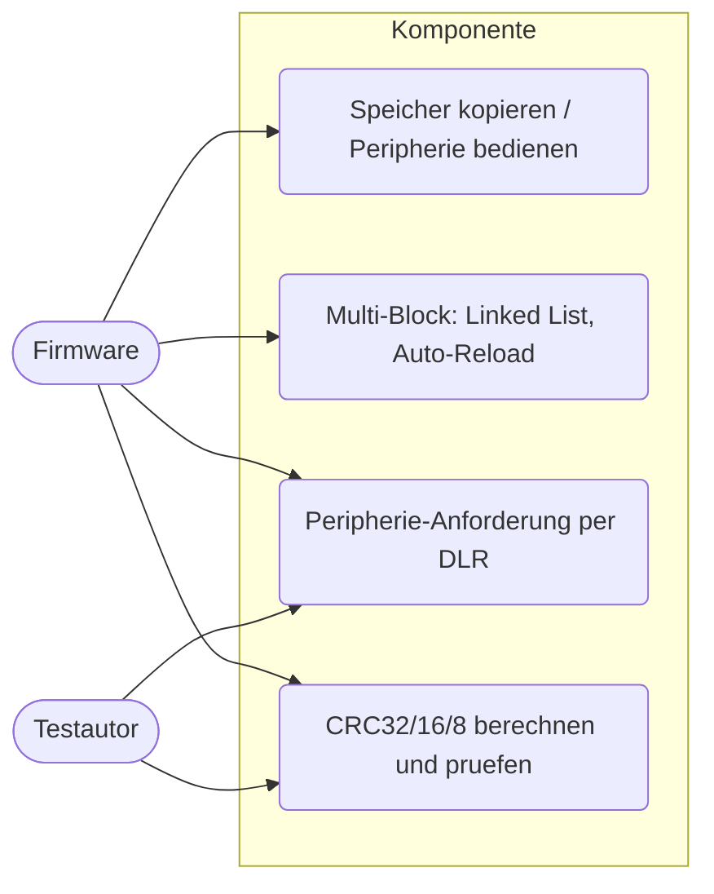
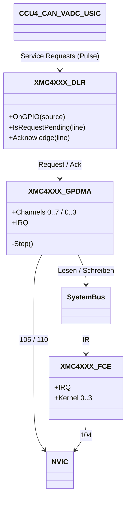
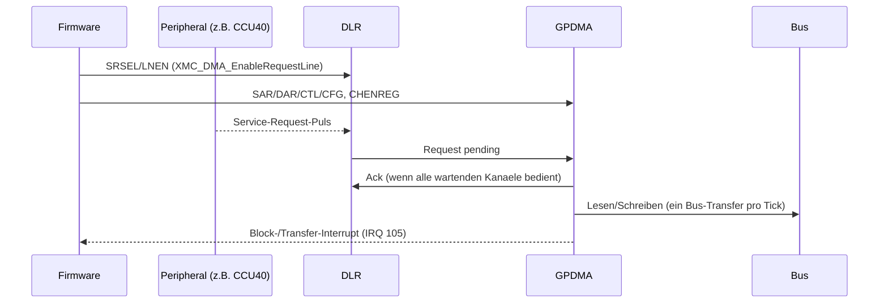
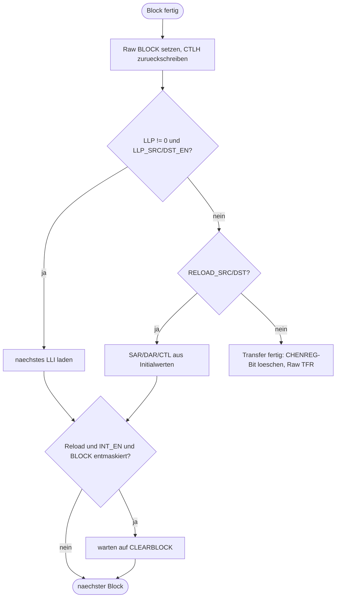

# GPDMA, DLR und FCE (`dma-fce`)

> Nachbildung der beiden General Purpose DMA Units (GPDMA0/1), des DMA Line Routers (DLR) und der Flexible CRC Engine (FCE) des XMC4500 für `DMA_M2M`, `DMA_Ring_Buffer`, `DMA_GPIO`, `DMA_PWM`, `DMA_FCE`, `FCE_CRC`, `UART_DMA`, `SPI_DMA`.

Referenz: Reference Manual v1.6, Kapitel 4.4 (DLR), 5 (GPDMA), 6 (FCE). Klassen: `XMC4XXX_GPDMA`, `XMC4XXX_DLR` (Ordner `DMA`), `XMC4XXX_FCE` (Ordner `CRC`).

## 1. Use Cases



## 2. Aufbau



Einbindung (`platforms/cpus/xmc4500.repl`): `fce @ 0x50020000` (IRQ 104), `dlr @ 0x50004900`, `gpdma0 @ 0x50014000` (8 Kanaele, IRQ 105, DLR-Linien 0-7), `gpdma1 @ 0x50018000` (4 Kanaele, IRQ 110, Linien 8-11). Der SCU-Adressbereich wurde auf 0x800 verkleinert, damit DLR (und ERU) hineinpassen.

DLR-Eingaenge (Nummern der Quellen, siehe Kommentar in `XMC4XXX_DLR.cs`): ERU 0-3, VADC C0 4-7, G0..G3 8-23, DSD 24-27, DAC 28-29, CCU40..43 30-37, CCU80/81 38-41, CAN 42-45, USIC0 46-47, USIC1 48-49, USIC2 50-53. Im repl verdrahtet: CCU40-43, CAN, DAC, VADC, USIC0 ch0, USIC1 ch1. ERU, DSD, CCU8 und USIC2 gibt es noch nicht.

Register (modelliert):

| Bereich | Offset | Verhalten |
|---|---|---|
| Kanal x: SAR, DAR, LLP, CTLL, CTLH, CFGL, CFGH, SGR, DSR, SSTAT.. | x*0x58 + 0x00.. | gespeichert; Adressen laufen waehrend des Transfers mit; BLOCK_TS liest die bereits uebertragenen Elemente |
| RAW/STATUS/MASK/CLEAR TFR, BLOCK, SRCTRAN, DSTTRAN, ERR | 0x2C0..0x358 | Roh-/maskierter Status, Mask mit Write-Enable (Bits 15:8), STATUSINT 0x360 |
| REQ/SGLREQ/LST SRC/DST | 0x368..0x390 | Software-Handshake |
| DMACFGREG, CHENREG (mit Write-Enable) | 0x398, 0x3A0 | Kanal-Enable, Bit wird am Transferende geloescht |
| DLR: OVRSTAT, OVRCLR, SRSEL0/1, LNEN | 0x00..0x10 | Quellenauswahl nach Tabelle 4-5, Request bleibt bis zum Ack gespeichert |
| FCE je Kern m: IR, RES, CFG, STS, LENGTH, CHECK, CRC, CTR | 0x20 + 0x20*m | CRC32 (Kern 0/1), CRC16 (2), CRC8 (3); CLC, ID |

## 3. Verhalten





CRC-Rechnung der FCE: jedes IR-Wort wird MSB zuerst in das CRC-Register geschoben (mit REFIN je Byte bitgespiegelt); RES = CRC, mit REFOUT ueber die Kernbreite gespiegelt und mit XSEL invertiert. Geprueft gegen die echten Hardware-Ausgaben im Screenshot des Beispiels `FCE_CRC` und den erwarteten Wert `0x99F69CD9` von `DMA_FCE`.

## 4. Vereinfachungen und bekannte Luecken

- Zeitverhalten: ein Bus-Transfer je Tick eines Timers mit `transferFrequency` (10 MHz); der Timer laeuft nur, solange ein Kanal weiterkommt. Burst-Laengen beeinflussen nur die Zahl der Elemente je Anforderung.
- Peripherie als Flusskontrolle (TT_FC >= 4) nicht unterstuetzt (Warnung, GPDMA wird Flusskontrolle). LST-Register, SSTAT/DSTAT-Abruf, FIFO_MODE/FCMODE/Locking/Polaritaet werden nur gespeichert.
- Fehlerinterrupt nur bei Zugriff auf nicht abgebildete Adressen.
- Das Request-Ack erfolgt beim Start der Transaktion, damit ein sofort folgender Puls der Peripherie nicht als Overrun verloren geht.
- Mehrere Kanaele auf derselben DLR-Linie (`DMA_PWM`) bedienen jeweils dieselbe Anforderung.
- FCE: Busfehler fuer schmale Schreibzugriffe (BEF) und redundante Register werden nicht nachgebildet; Schreiben auf CHECK/LENGTH nur nach dem Schluessel 0xFACECAFE; Schreibzugriffe bei gesetztem `CLC.DISR` (Reset-Zustand) werden ignoriert. 
- `XMC4XXX_UART` erhielt `AllowedTranslations` (Byte-/Wortzugriffe der DMA). Das USIC feuert noch keine Service-Request-Pulse pro Ereignis und kennt `FMR.SIOx` nicht; daher injizieren die Tests `Ring_Buffer` und `UART_DMA` die USIC0.SR0-Anforderung ueber `dlr OnGPIO 46 true`. `SPI_DMA` braucht den USIC-SPI-Kanal (USIC1 ch0) und ist uebersprungen.

## 5. Manuell nachvollziehen

```bash
scripts/xmc4500/run-example.sh FCE_CRC 1          # Ausgabe wie im README-Screenshot (RES = 0xdf65a96d ...)
scripts/xmc4500/run-example.sh DMA_FCE 0 "emulation RunFor '0.2'; sysbus.port1.led1 State"   # True
scripts/xmc4500/run-example.sh DMA_M2M 0 "emulation RunFor '0.05'; sysbus.port1.led1 State"  # True
```

## 6. Tests

Datei: `tests/platforms/xmc4500/dma-fce.robot`, Start: `scripts/xmc4500/test.sh dma-fce`.

| Test-Case | Beispiel | Prueft |
|---|---|---|
| Copy Memory To Memory | `DMA_M2M` | LED1, `destination_data` = 0..9, Kanal danach frei |
| Drive The LEDs With A GPDMA Pattern | `DMA_GPIO` | Tastverhaeltnis LED1 0,5 / LED2 0,25, Kanal bleibt aktiv |
| Compute The CRC32 With DMA | `DMA_FCE` | LED1, RES = 0x99F69CD9, keine Fehlerflags |
| Print Reference CRCs | `FCE_CRC` | RES-Werte wie auf echter Hardware, Mismatch/Length-Error, LED1 |
| Match Known CRC Check Values | FCE direkt | CRC8 "123456789" = 0x4B, CRC32 gegen zlib, RES-Reset |
| Check The Signature And Flag Errors | FCE direkt | CHECK/LENGTH, CMF, LEF, Schluessel, CTR.FCM |
| Fill The Ring Buffer ... | `DMA_Ring_Buffer` | P2M mit Hardware-Handshake, Echo "AB" (Request per Hand) |
| Send Two Buffers ... | `UART_DMA` | M2P je Anforderung ein Byte, 2 x 256 Zeichen (Request per Hand) |
| Change The PWM Compare Value ... | `DMA_PWM` | Linked List, CR steigt/faellt in Schritten von 1365 |
| Transfer SPI Data ... | `SPI_DMA` | uebersprungen (USIC-SPI fehlt) |

Der CRC32 von "123456789" (0xCBF43926) laesst sich auf der Hardware nicht direkt pruefen: Kern 0/1 nehmen nur 32-Bit-Woerter; verwendet wurden "12345678" (zlib) und das CRC8-Pruefwort.
