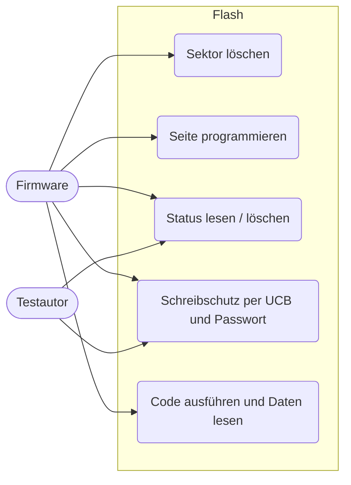
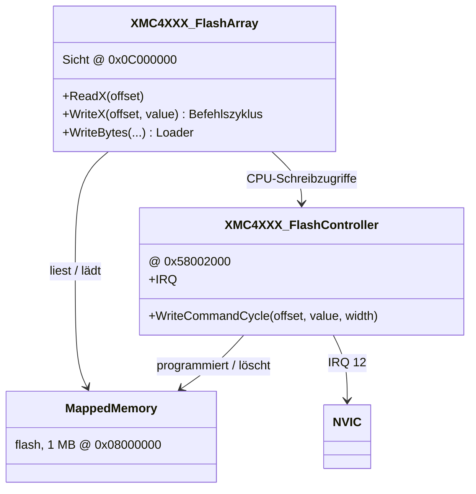
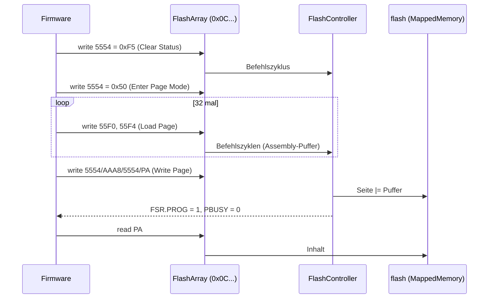
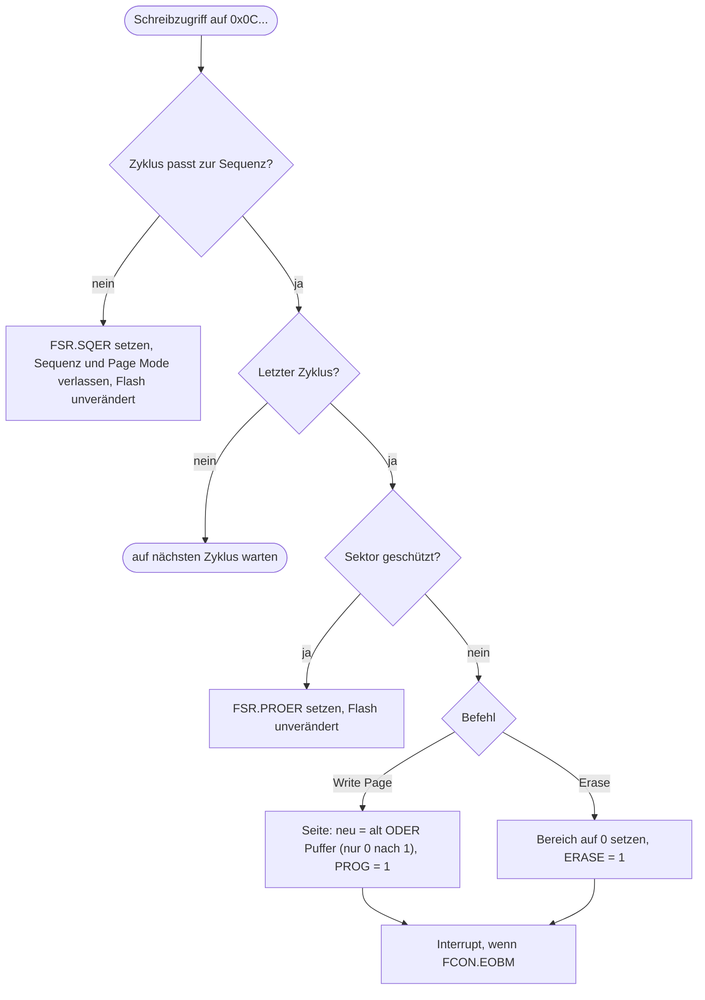

# Flash (`flash`)

> FLASH0 des XMC4500: Befehlsinterpreter für Programmieren und Löschen des Programmflash, Statusregister FSR, FCON, MARP, PROCONx und Schreibschutz über die UCBs; für `Flash_Program` und `Flash_EEPROM`.

Referenz: Reference Manual v1.6, Kapitel 8 "Flash and Program Memory Unit (PMU)" (8.4 Funktionen, 8.7 Register). Beispiele: `Flash_Program`, `Flash_EEPROM`.

## 1. Use Cases



## 2. Aufbau



Der Speicher selbst ist ein `MappedMemory` am gecachten Alias `0x08000000` (schnelle Codeausführung). Der nicht gecachte Alias `0x0C000000` ist eine nicht gemappte Sicht (`XMC4XXX_FlashArray`) auf denselben Speicher: Lesen liefert den Inhalt, jedes CPU-Schreiben ist ein Befehlszyklus. Der Loader (LoadELF, `sysbus WriteBytes`) schreibt Mehrbyte-Blöcke direkt in den Speicher.

Register (Basis `0x58002000`):

| Offset | Register | Verhalten |
|---|---|---|
| 0x008 | ID | 0x00A2C001 |
| 0x010 | FSR | PBUSY/FABUSY immer 0; PROG, ERASE, PFPAGE, SQER, PROER, PROIN, RPROIN, RPRODIS, WPROIN0-2, WPRODIS0/1 aus dem Befehlszustand; Rest 0 |
| 0x014 | FCON | Reset 0x6; WSPFLASH, WSECPF, IDLE, ESLDIS, SLEEP, Interrupt-Masken (EOBM, SQERM, PROERM, ...) speichern; RPA aus PROCON0 und RPRODIS; DCF/DDF nur bei RPA = 0 löschbar |
| 0x018 | MARP | MARGIN, TRAPDIS nur gespeichert |
| 0x020-0x028 | PROCON0-2 | schreibgeschützt, beim Reset aus den UCBs geladen |

Sektoren (Tabelle 8-2): S0-S7 je 16 KB (0x00000-0x1FFFF), S8 128 KB (0x20000), S9-S11 je 256 KB (0x40000, 0x80000, 0xC0000). Physikalische Sektoren: PS0 = S0-S3, PS4 = S4-S7, dann S8-S11.

Befehlssequenzen (Adressen relativ zum Flash, nur untere 16 Bit zählen; Daten: nur das Byte):

| Befehl | Zyklen |
|---|---|
| Reset to Read | 5554 F0 |
| Enter Page Mode | 5554 50 |
| Load Page | 55F0 WD, 55F4 WD (32 mal) |
| Write Page | 5554 AA, AAA8 55, 5554 A0, PA AA |
| Write User Config Page | 5554 AA, AAA8 55, 5554 C0, UCPA AA |
| Erase Sector / Physical Sector / UCB | 5554 AA, AAA8 55, 5554 80, 5554 AA, AAA8 55, SA 30 / 40 / C0 |
| Disable Sector Write Protection | 5554 AA, AAA8 55, 553C UL, AAA8 PW0, AAA8 PW1, 5558 05 |
| Disable Read Protection | wie oben mit UL = 0 und 5558 08 |
| Resume Protection | 5554 5E |
| Clear Status | 5554 F5 |

## 3. Verhalten





Wichtig: Der gelöschte Zustand dieses Flash ist logisch 0, Programmieren setzt Bits auf 1 (RM 8.4.2). Programmieren kann also keine Bits löschen. Flash_Program erwartet das: löschen, Seite programmieren, vergleichen.

Schutz: Die UCBs (3 x 1 KB) sind als eigener nichtflüchtiger Speicher modelliert (überleben `Reset`). Beim Reset des Controllers werden PROCONx, FSR.WPROINx und die Confirmation (0x8AFE15C3 in Seite 2) daraus neu berechnet, wie beim Hochlauf der Hardware. Gesperrte Sektoren erzeugen bei Write Page / Erase PROER; ein falsches Passwort sperrt weitere Passwortbefehle bis zum Reset.

## 4. Vereinfachungen und bekannte Lücken

- Alle Operationen sind sofort fertig; FSR.PBUSY ist nie 1. Der End-of-Busy-Interrupt (FCON.EOBM, IRQ 12) kommt sofort.
- Schreibzugriffe auf den gecachten Alias `0x08000000` werden nicht abgefangen und ändern den Flash direkt (der Speicher dort ist gemappt). Nur der nicht gecachte Alias verhält sich wie die Hardware.
- Kein ECC (PFSBER/PFDBER immer 0), keine Margin-Wirkung, kein Sleep, kein Busfehler bei Leseschutz oder Lesen während Busy; FSR.VER und PFOPER werden nie gesetzt.
- UCB-Inhalt ist nicht über Adressen lesbar (nur über PROCONx/FSR sichtbar); die Sektor-/UCB-Adressierung entspricht Tabelle 8-1.
- PMU0_ID (0x58000508) fehlt.
- Lesen aus dem ungecachten Alias läuft über C# (langsamer als der gecachte Alias).
- Vom Basismodell: USIC1 Kanal 1 (`usic1ch1` @ 0x48020200, IRQ 90-95) wurde additiv in `xmc4500.repl` ergänzt, weil `Flash_EEPROM` darüber ausgibt.
- Abhängigkeit: `Flash_EEPROM` berechnet seine Prüfsummen mit dem FCE (Komponente `dma-fce`). Solange dieser nicht im Modell ist, lädt der Test den Ersatz `tests/platforms/xmc4500/flash_fce_stub.py` (keine echte CRC32, nur deterministisch).

## 5. Manuell nachvollziehen

```bash
scripts/xmc4500/build-example.sh Flash_Program
scripts/xmc4500/run-example.sh Flash_Program 0 "emulation RunFor '0.2'; sysbus ReadDoubleWord 0x0C01C000; sysbus ReadDoubleWord 0x58002010"
# erwartet: 0x11111111 und FSR = 0x10 (PROG)
```

`Flash_EEPROM` gibt über `usic1ch1` aus (`showAnalyzer sysbus.usic1ch1`): "Existing Data in EEPROM" und "New Data in EEPROM", jeweils 50 Bytes; nach `machine Reset; cpu VectorTableOffset 0x08000000` zählen die Daten weiter (0x01, 0x02, ...). Ohne FCE-Modell vorher `machine PyDevFromFile @tests/platforms/xmc4500/flash_fce_stub.py 0x50020000 0x100 True "fceStub"`.

## 6. Tests

Datei: `tests/platforms/xmc4500/flash.robot`, Start: `scripts/xmc4500/test.sh flash`.

| Test-Case | Beispiel | Prüft |
|---|---|---|
| Should Erase And Program A Sector In Flash_Program | `Flash_Program` | Sektor 7 gelöscht, Seite programmiert (Inhalt, Rest 0), FSR.PROG, LED blinkt |
| Should Keep Data In The Emulated EEPROM Across Resets | `Flash_EEPROM` | UART-Ausgabe, Daten zählen über Resets hinweg weiter (0x01, 0x02) |
| Should Not Change Flash Without A Command Sequence | - | Schreiben ohne Sequenz ändert den Flash nicht, SQER, Clear Status |
| Should Only Turn Bits To One When Programming | - | Programmieren ist ODER, Erase setzt auf 0 |
| Should Report Sequence Errors | - | Load/Write Page ohne Page Mode, falsche Sektoradresse, Reset to Read |
| Should Enter And Leave Page Mode | - | FSR.PFPAGE |
| Should Erase A Physical Sector | - | Erase Physical Sector löscht PS4 (S4-S7) |
| Should Enforce Sector Write Protection | - | UCB0-Schutz für S7, PROCON0, PROER, Passwort-Handshake |
