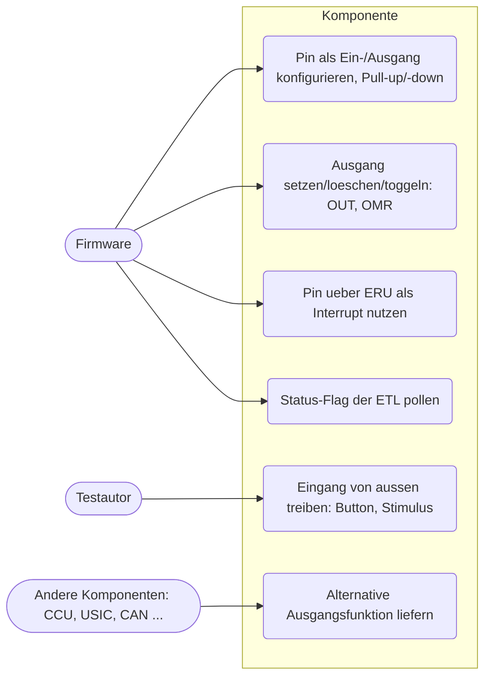
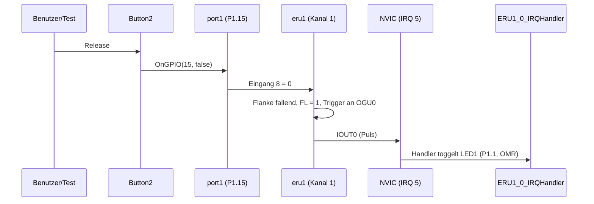
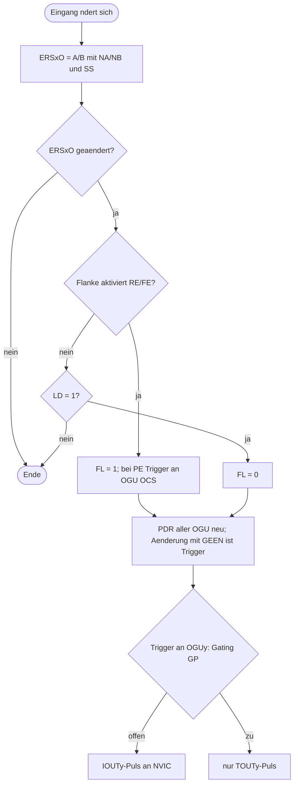

# Ports und Event Request Unit (`gpio-eru`)

> Nachgebildet werden die GPIO-Ports P0-P6, P14, P15 (`XMC4XXX_GPIOPort`) und die zwei Event Request Units ERU0/ERU1 (`XMC4XXX_ERU`) für die Beispiele `GPIO_Toggle`, `ERU_EXTINT` und `ERU_HIB_IO`.

Referenz: Reference Manual v1.6, Kapitel 25 "General Purpose I/O Ports (PORTS)" und 4.5/4.10.2/4.11 "Event Request Unit (ERU)"; Pin-Zuordnung ERU aus `xmc4_eru_map.h` (XMC4500, LQFP100). Beispiele: `GPIO_Toggle`, `ERU_EXTINT`, `ERU_HIB_IO`.

## 1. Use Cases



## 2. Aufbau

```mermaid
classDiagram
    class BaseGPIOPort
    class XMC4XXX_GPIOPort {
        +OnGPIO(number, value)
        +SetAlternateOutput(pin, function, value)
        +GetPadLevel(pin)
        Connections 0..n-1: Treiberpegel
        Connections n..2n-1: Pegel fuer Peripherals
    }
    class XMC4XXX_ERU {
        +OnGPIO(input, value)
        Connections 0-3 IOUT, 4-7 PDOUT, 8-11 GOUT, 12-15 TOUT
    }
    BaseGPIOPort <|-- XMC4XXX_GPIOPort
    XMC4XXX_GPIOPort --> XMC4XXX_ERU : Pad-Pegel (Pin zu ERU-Eingang)
    XMC4XXX_ERU --> NVIC : IOUT0-3 (ERU0: 1-4, ERU1: 5-8)
    Button --> XMC4XXX_GPIOPort : Pad treiben
    XMC4XXX_GPIOPort --> LED : Treiberpegel
```

### Ports

Basisadressen `0x48028000 + n*0x100` (P0-P6, P14 `0x48028E00`, P15 `0x48028F00`). Registerlayout aus Kapitel 25.8.

| Offset | Register | Verhalten |
|---|---|---|
| 0x00 | OUT | Ausgangs-Latch, alle 16 Bits speicherbar |
| 0x04 | OMR | PSx setzt, PRx loescht, beide toggeln; liest 0 |
| 0x10-0x1C | IOCR0-12 | PCx (5 Bit je Pin): 0b0xxxx Eingang (Bits 1:0 Pull: 1 Pull-down, 2 Pull-up, 3 "OUT sampelt Eingang"; Bit 2 invertiert), 0b10000 Push-Pull, 0b11000 Open-Drain, 0b1x001-0b1x100 alternative Ausgaenge 1-4 |
| 0x24 | IN | Pegel am Pad (Ausgang: eigener Ausgangspegel) |
| 0x40/0x44 | PDR0/1 | gespeichert, Reset `0x22222222` (nicht bei P14/P15) |
| 0x60 | PDISC | P0-P6 nur lesbar (nicht herausgefuehrte Pads = 1), P14/P15 schreibbar: gesetztes Bit = Digitaleingang abgeschaltet, IN liest 0 |
| 0x70 | PPS | gespeichert |
| 0x74 | HWSEL | gespeichert; Reset P0 `0x14000`, P2 `0x4`, sonst 0 |

Pin-Anzahl und PDISC-Reset im Modell (LQFP-100, Tabelle 25-10): P0 Pins 0-12, P1 0-15, P2 0-10/14/15, P3 0-6, P4 0-1, P5 0/1/2/7, P6 keine, P14 und P15 alle 16 Pads zunaechst abgeschaltet. Die Parameter `numberOfPins`, `pinDisableResetValue`, `analogPort`, `hwselResetValue` stehen in `xmc4500.repl`.

**Pegelmodell**: Ausgangspin: Pad = Ausgangspegel. Eingangspin: Pad = von aussen getriebener Pegel (`OnGPIO`), sonst der Pegel des Pull-Geraets (Pull-up 1, sonst 0). Open-Drain mit 1 laesst die Leitung los (folgt dem externen Pegel, sonst 1).

**GPIO-Verbindungen eines Ports** (n = `numberOfPins`):

| Richtung | Nummer | Bedeutung |
|---|---|---|
| Ausgang | 0..n-1 | Treiberpegel des Pins (LEDs im Board: `1 -> led1@0`) |
| Ausgang | n..2n-1 | Pegel, den Peripherals am Pin sehen (Pad-Pegel, bei invertiertem Eingang negiert); damit werden Pins mit ERU-Eingaengen und anderen Peripherals verbunden |
| Eingang | 0..n-1 | Pad von aussen treiben (Button, Test) |
| Eingang | alt*n + pin | Pegel der Alternativfunktion alt (1-4) von aussen (siehe unten) |

### Mechanismus fuer Alternativfunktionen (fuer andere Komponenten)

Ein Peripheral (CCU, USIC, CAN ...) liefert den Pegel seines Ausgangssignals an einen Pin entweder per C#-Aufruf `port.SetAlternateOutput(pin, function, level)` oder per GPIO-Verbindung in der `.repl` auf Eingang `function*n + pin` des Ports. Er erscheint am Pad (und an den Connections), sobald die Firmware IOCR auf diese Funktion stellt (`PCx = 0b10000 | function`, Open-Drain `0b11000 | function`). Eingangssignale fuer Peripherals greift man an den Connections n..2n-1 ab. Die Zuordnung Pin/Funktion zu Signal ist nicht Teil dieser Komponente und im Modell nicht verdrahtet.

Beispiel (`.repl`, P1 hat n = 16; Funktion 2 von P1.5 wird von `ccu40` Ausgang 0 getrieben):
```
ccu40:
    0 -> port1@37
```

### ERU

`eru0` bei `0x50004800`, `eru1` bei `0x40044000`. Der SCU-Registerblock endet in der `.repl` bei `0x50004800`, damit ERU0 Platz hat.

| Offset | Register | Verhalten |
|---|---|---|
| 0x00 | EXISEL | EXSxA/EXSxB waehlen den Eingang A0-3 bzw. B0-3 je Kanal |
| 0x10+4x | EXICONx | PE, LD, RE, FE, OCS, FL (schreibbar), SS, NA, NB |
| 0x20+4y | EXOCONy | ISS, GEEN, PDR (nur lesbar, Reset 1), GP, IPEN0-3; Reset `0x8` |

ERU-GPIO-Eingaenge: `x*8+0..3` = A0-A3, `x*8+4..7` = B0-B3 (Kanal x), `32+y*4+k` = Peripherie-Trigger ERU_OGUyk (k = 1..3). Ausgaenge: `y` IOUT, `4+y` PDOUT, `8+y` GOUT, `12+y` TOUT. IOUT0-3 gehen an NVIC 1-4 (ERU0, `ERU0_0_IRQn`...) und 5-8 (ERU1); die Nummern stehen so in `XMC4500.h`. ERU1 fuehrt IOUT2/IOUT3 intern auf die Eingaenge 1A3, 1B3 (IOUT2) und 0B3 (IOUT3) zurueck.

Die Pin-zu-Eingang-Zuordnung (LQFP-100) steht im ERU-Block von `xmc4500.repl` (z. B. P1.15 -> ERU1 Kanal 1 A0 = Eingang 8, P1.5 -> ERU0 2A0 und ERU1 0A0).

Einbindung:
```
eru1: Miscellaneous.XMC4XXX_ERU @ sysbus 0x40044000
    internalLoopback: true
    [0-3] -> nvic@[5-8]
```

## 3. Verhalten





## 4. Vereinfachungen und bekannte Luecken

- Kein Synchronisationsdelay, Ausgangspulse haben die Laenge 0 (Set/Unset sofort); NVIC erhaelt trotzdem den Pending-Zustand.
- Schreiben von EXISEL, SS/NA/NB oder der Pattern-Felder erzeugt nie ein Ereignis, nur Eingangsaenderungen und Software-Schreiben von FL.
- Peripherie-Trigger = steigende Flanke des gewaehlten ERU_OGUyk-Eingangs.
- PPS/Deep-Sleep-Verhalten, HWSEL-Hardwaresteuerung und Pad-Treiber sind nur gespeichert; "OUT sampelt Eingang" (PC = 0bx0011) ist umgesetzt.
- Ein "getriebener" Pin ist jeder, der einmal `OnGPIO` erhalten hat (auch ein verbundener, losgelassener Button). Die Pull-Geraete wirken daher nur an unverbundenen Pins.
- Invertierter Eingang (PC Bit 2) wirkt auf die Peripherie-Sicht (Connections n..2n-1), nicht auf IN.
- Die Zuordnung der PDISC-Reset-Werte (nicht herausgefuehrte Pads = 1) folgt der Formulierung des Handbuchs, das den Wert als paketabhaengig nennt.
- Buttons und LEDs sind aktiv-high angenommen: das Beispiel `ERU_EXTINT` (fallende Flanke) loest daher beim Loslassen von BUTTON2 aus.
- ERU_HIB_IO: Der Hibernate-Teil (HIB_IO_1 -> SCU.HIB_SR0 -> ERU0.1A1) gehoert zu `scu-wdt-rtc`. Der Test stoesst die Flanke direkt am ERU-Eingang 9 an; der Pfad ueber die SCU ist als `skip` markiert.

## 5. Manuell nachvollziehen

```bash
scripts/xmc4500/run-example.sh GPIO_Toggle 0 "emulation RunFor '1.5'; sysbus.port1.led1 State; emulation RunFor '1'; sysbus.port1.led1 State"
# erwartet: True, danach False

scripts/xmc4500/run-example.sh ERU_EXTINT 0 "emulation RunFor '0.5'; sysbus.port1.button2 PressAndRelease; emulation RunFor '0.1'; sysbus.port1.led1 State"
# erwartet: True (LED1 getoggelt), BUTTON1 (P1.14) wirkt nicht

scripts/xmc4500/run-example.sh ERU_HIB_IO 0 "emulation RunFor '2'; sysbus.eru0 OnGPIO 9 true; sysbus.eru0 OnGPIO 9 false; sysbus.port1.led1 State; emulation RunFor '2'; sysbus.port1.led1 State"
# erwartet: zweimal derselbe Wert (Blinken gestoppt)
```

## 6. Tests

Datei: `tests/platforms/xmc4500/gpio-eru.robot`, Start: `scripts/xmc4500/test.sh gpio-eru`.

| Test-Case | Beispiel | Prueft |
|---|---|---|
| GPIO Toggle Blinks LED1 With 0.5 Hz | `GPIO_Toggle` | LED1 blinkt im 1-s-Takt (OMR-Toggle aus SysTick) |
| GPIO Port Registers Behave Like The Reference Manual | `Empty_XMC_App` | Reset-Werte (HWSEL, PDR, PDISC), OUT/OMR, Pull-up/-down, getriebener Pin, analoger Port P14 |
| ERU Extint Toggles LED1 On Every Falling Edge Of Button2 | `ERU_EXTINT` | Interrupt nur bei fallender Flanke, LED1 und `interrupt_event_count` |
| ERU Extint Ignores Button1 | `ERU_EXTINT` | P1.14 ist kein ERU-Eingang, kein Interrupt |
| ERU HIB IO Stops Blinking On Falling Edge At ERU0 Input 1A1 | `ERU_HIB_IO` | LED blinkt, FL nur bei fallender Flanke, danach bleibt die LED stehen |
| ERU HIB IO Detects HIB_IO_1 Through The Hibernate Domain | `ERU_HIB_IO` | skip: Hibernate-Domain gehoert zu `scu-wdt-rtc` |
