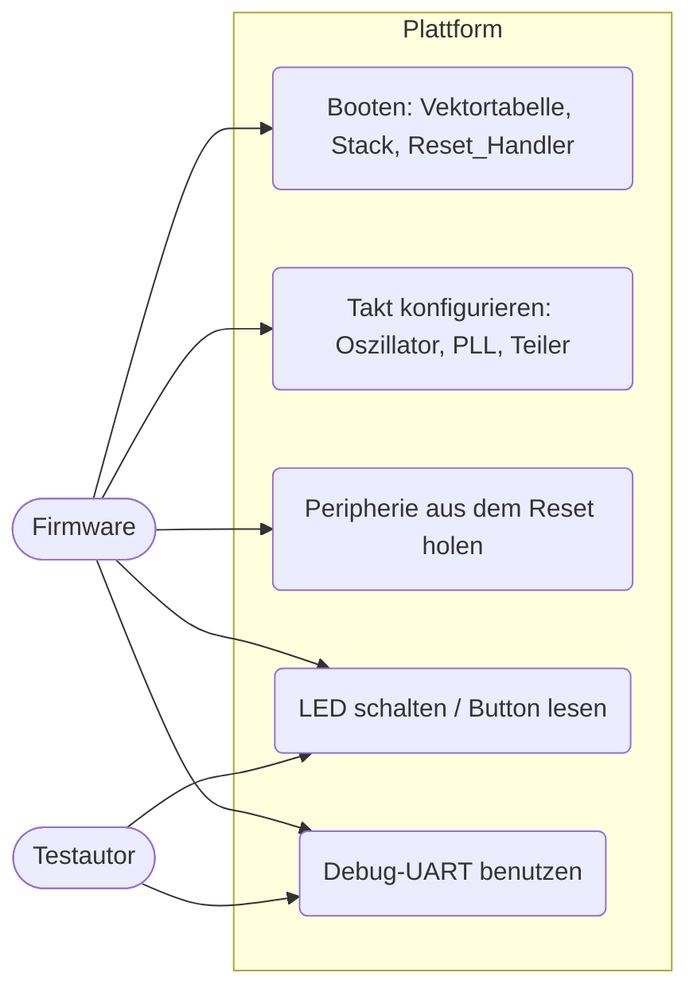
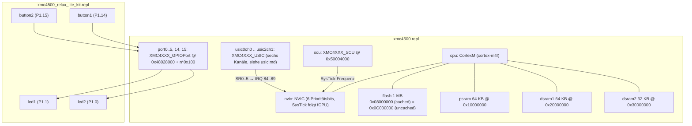
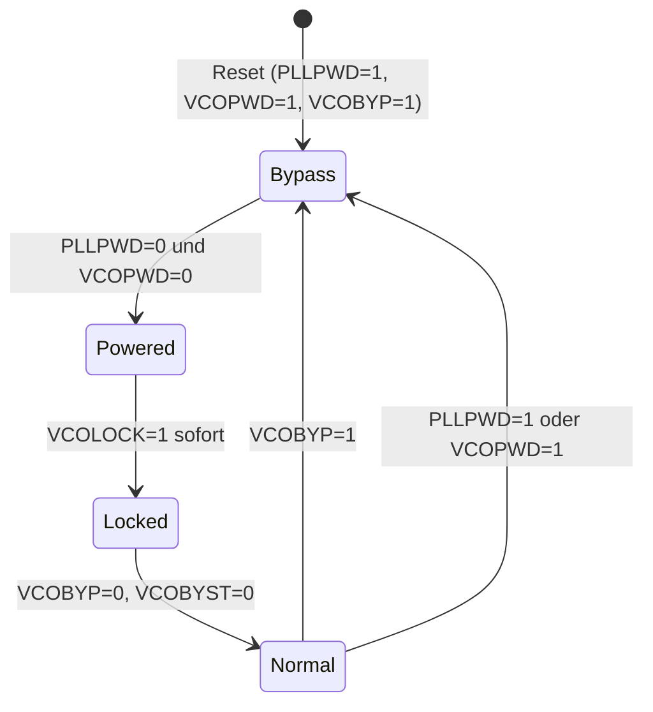

# Plattform: CPU, Speicher, SCU, Board (`platform`)

> Basis aller anderen Komponenten: Cortex-M4F mit NVIC, die vier Speicherbereiche, die System Control Unit (Takt, PLL, Power, Reset) und das Relax-Lite-Kit-Board (LEDs, Buttons).

Referenz: Reference Manual v1.6, Kapitel "System Control Unit (SCU)" und "Memory Organization"; Kit-Beschreibung "XMC4500 Relax / Relax Lite Kit". Beispiele: `UART_Printf`, `Empty_XMC_App`.

## 1. Use Cases



## 2. Aufbau



Wichtige Entscheidungen (aus Fehlersuche entstanden):

- Flash ist **ein** Speicher mit zwei Adressen; Firmware wird mit Ladeadresse `0x0C000000` geladen und läuft bei `0x08000000`.
- Der NVIC braucht in der `.repl` `IRQ -> cpu@0`, sonst werden Exceptions pending, aber nie ausgeführt.
- Die SysTick-Frequenz folgt dem Takt, den die Firmware über SCU-Register konfiguriert (Beispiele nutzen 72 MHz statt 120 MHz).
- LEDs/Buttons sind aktiv-high angenommen.

### SCU (`XMC4XXX_SCU`)

| Bereich | Offset | Verhalten im Modell |
|---|---|---|
| Power (PWRSTAT/SET/CLR) | 0x200 | Status/Set/Clear-Trio |
| Hibernate (HDSTAT/SET/CLR/HDCR) | 0x300 | Trio, Mirror-Update (`MIRRSTS` 0xC4) immer fertig |
| Reset (RSTSTAT/SET/CLR, PRSTATn/PRSETn/PRCLRn) | 0x400, 0x40C+12n | Trio |
| Clock (CLKSTAT/SET/CLR, SYSCLKCON …) | 0x600 | Teiler/Quelle gespeichert, SysTick-Frequenz abgeleitet |
| Oszillator + PLL (OSCHP*, PLLSTAT/CON0-2) | 0x700 | Lock/Bypass/Usable aus Kontrollbits abgeleitet |

## 3. Verhalten

Start der Firmware und Taktaufbau (`SystemInit` → `SystemCoreClockSetup`):

```mermaid
sequenceDiagram
    participant FW as Firmware (Reset_Handler)
    participant CPU as CortexM
    participant SCU as XMC4XXX_SCU
    participant NV as NVIC
    Note over CPU: Renode: PC/SP aus ELF, VTOR = 0x08000000
    FW->>SCU: PWRSET.HIB; poll PWRSTAT.HIBEN
    SCU-->>FW: HIBEN = 1
    FW->>SCU: HDCLR / OSCULCTRL / HDCR (Mirror-Handshake)
    SCU-->>FW: MIRRSTS = 0 (sofort)
    FW->>SCU: PLLCON0: Oszillator & PLL einschalten
    FW->>SCU: PLLCON1: N, K1, K2, P
    FW->>SCU: poll PLLSTAT.VCOLOCK
    SCU-->>FW: VCOLOCK = 1 (PLL nicht im Power-Down)
    FW->>SCU: PLLCON0.VCOBYP = 0; poll PLLSTAT.VCOBYST = 0
    FW->>SCU: SYSCLKCON, CPUCLKCON, PBCLKCON
    SCU->>NV: Frequency = fCPU
    FW->>NV: SysTick_Config(fCPU / 1000)
```

PLL-Zustände im Modell:



## 4. Vereinfachungen und bekannte Lücken

- Kein Boot-ROM, kein Debugger, keine Flash-Wait-States (`0x58002000` ist nur ein Speicherblock).
- Die SCU ist seit der Komponente `scu-wdt-rtc` deutlich erweitert (Service Requests, Traps, Brownout, Hibernate, WDT, RTC), siehe [scu-wdt-rtc.md](scu-wdt-rtc.md). Die Tabelle oben zeigt nur den Umfang der ersten Version.
- Die Takt-Statusregister laufen sofort, Frequenzen werden nicht über die Zeit hochgefahren.

## 5. Manuell nachvollziehen

```bash
scripts/xmc4500/build-example.sh UART_Printf
scripts/xmc4500/run-example.sh UART_Printf 1
# erwartet: "Initialization done" und "Hello World!" im Log (usic0ch0)
scripts/xmc4500/run-example.sh GPIO_Toggle 0 "emulation RunFor '1.5'; sysbus.port1.led1 State; emulation RunFor '1'; sysbus.port1.led1 State"
# erwartet: True, danach False (LED1 blinkt mit 0,5 Hz)
```

## 6. Tests

Datei: `tests/platforms/xmc4500/platform.robot`, Start: `scripts/xmc4500/test.sh platform`.

| Test-Case | Beispiel | Prüft |
|---|---|---|
| Should Boot And Print With Printf Retargeted To USIC0 Channel 0 | `UART_Printf` | Speicherlayout, Vektortabelle, SCU-Taktaufbau, USIC-UART-Ausgabe |
| Should Boot Empty Application Without Unhandled Accesses | `Empty_XMC_App` | keine Zugriffe auf nicht vorhandene Peripherals im Startcode |
