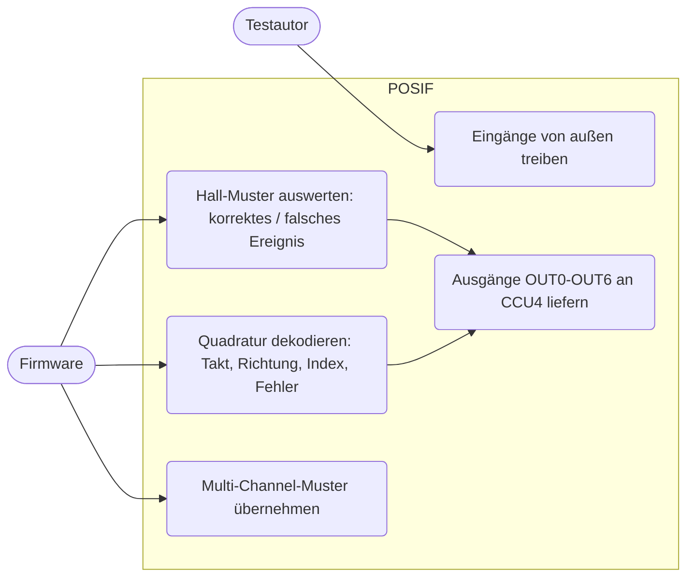
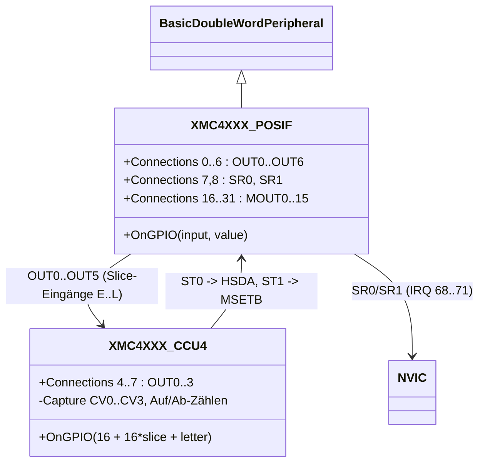
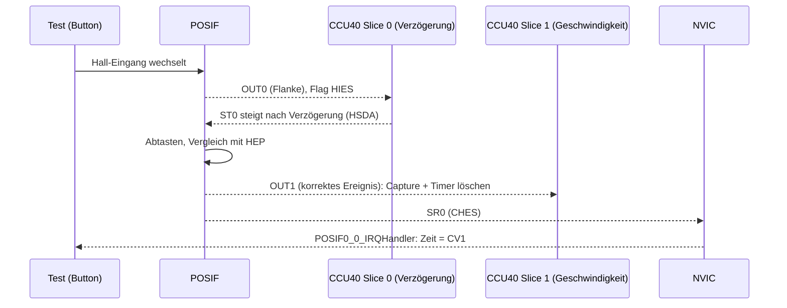
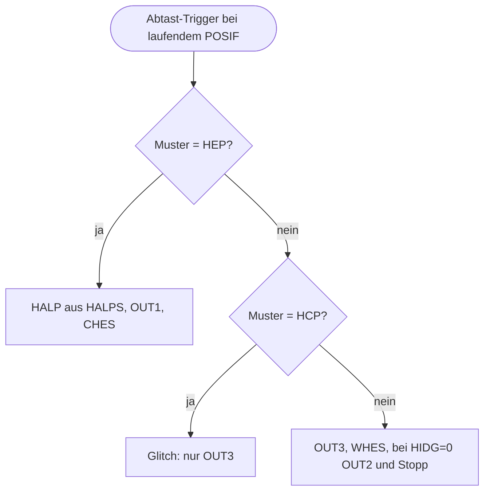

# Position Interface (`posif`)

> Nachbildung der beiden Position Interfaces POSIF0/POSIF1 des XMC4500 im Hall-Sensor-Modus und im Quadratur-Decoder-Modus für `POSIF_Hall` und `POSIF_QD`; dazu eine Erweiterung der CCU4 um Capture-Modus, Auf-/Abwärtszählen und Eingänge je Slice.

Referenz: Reference Manual v1.6, Kapitel 24 "Position Interface Unit (POSIF)" (Register 24.7, Interconnects 24.8), Kapitel 22 (CCU4). Beispiele: `POSIF_Hall`, `POSIF_QD`.

## 1. Use Cases



## 2. Aufbau



Eingänge (`OnGPIO`-Nummer): 0-3 IN0A-D (Hall 1 / Phase A), 4-7 IN1A-D (Hall 2 / Phase B), 8-11 IN2A-D (Hall 3 / Index), 12-15 HSDA-D, 16-19 EWHEA-D, 20-27 MSETA-H, 28-31 MSYNCA-D. Ein Test treibt z. B. `sysbus.posif0 OnGPIO 1 true` (IN0B) oder nutzt die Buttons der Test-`.repl`.

| Offset | Register | Verhalten |
|---|---|---|
| 0x00 | PCONF | FSEL, QDCM, HIDG, MCUE, INSEL0-2, DSEL, SPES, MSETS, MSES, MSYNS, EWIS/EWIE/EWIL gespeichert und ausgewertet; LPC nur gespeichert |
| 0x04 | PSUS | gespeichert |
| 0x08/0x0C/0x10 | PRUNS/PRUNC/PRUN | Run-Bit; SRB erzeugt den Synchronstart-Puls OUT5; CSM setzt Decoder, HALP, MCM zurück |
| 0x20 | MIDR | 0x00A8C008 |
| 0x30/0x34 | HALP / HALPS | aktuelles/erwartetes Muster, Schatten; Übernahme bei korrektem Hall-Ereignis und per MCMS.STHR |
| 0x40-0x50 | MCM, MCSM, MCMS, MCMC, MCMF | Multi-Channel-Muster mit Schatten, MNPS/MNPC/STMR/MPC, MSS |
| 0x60 | QDC | PALS, PBLS, PHS, ICM; DVAL (Bit 8) = Richtung |
| 0x70-0x7C | PFLG, PFLGE, SPFLG, RPFLG | alle 9 Flags, Freigabe und SR0/SR1-Auswahl |
| 0x100 | PDBG | QCSV, QPSV, IVAL, HSP |

Einbindung in `platforms/cpus/xmc4500.repl` (Auszug; POSIF1 analog bei 0x4002C000, IRQ 70/71, CCU41/CCU43):

```
posif0: Miscellaneous.XMC4XXX_POSIF @ sysbus 0x40028000
    7 -> nvic@68
    8 -> nvic@69
    0 -> ccu40@20 | ccu40@36 | ccu40@52     // OUT0 -> IN0E, IN1E, IN2E von CCU40
    ...
ccu40:
    4 -> posif0@12                           // ST0 -> HSDA
```

Änderungen an `XMC4XXX_CCU4` (CCU4-Modell der Komponente `ccu4`, additiv): Capture-Modus (CMC.CAP0S/CAP1S, CV0-CV3 mit Full-Flags, TC.CCS, TC.SCE, TC.CAPC Timer löschen, TC.CMOD lesbar), Auf-/Abwärtszählen eines extern getakteten Slices (CMC.UDS, aktives Ereignis = abwärts, TCST.CDIR) und `OnGPIO(16 + 16 * Slice + Buchstabe)` für Eingänge einzelner Slices (die Hardware routet die POSIF-Ausgänge je Slice auf andere Buchstaben).

## 3. Verhalten





Quadratur: Zustand (A,B) mit Aktivpegeln und Phasentausch; Schritt im Gray-Code in Vorwärtsrichtung (00 -> 10 -> 11 -> 01) ist im Uhrzeigersinn. Jeder gültige Schritt: OUT1 = Richtung (Pegel), Puls OUT0 (CNTS), bei unveränderter Richtung auch OUT2 (PCLKS), bei Richtungswechsel DIRS; beide Phasen gleichzeitig: ERRS. Index wird beim nächsten gültigen Schritt ausgewertet (ICM bestimmt OUT3). Direction-Count-Modus: steigende Flanke von IN0 = Takt, IN1 = Richtung.

## 4. Vereinfachungen und bekannte Lücken

- Kein POSIF-Takt: Dekodierung ohne Verzögerung; die Eingangsfilter (PCONF.LPC) sind nur gespeichert; Suspend nicht modelliert.
- Indexspeicher des Quadratur-Decoders vereinfacht (nächster gültiger Schritt statt gleicher Flanke).
- MSET-/MSYNC-Quellen sind nur im Modell vorhanden, verdrahtet sind nur HSDA (ST0 von CCU40/41) und MSETB/MSETD; SR0 von CCU4 und PS1 (MSETA/MSYNCC) sowie CCU8-Signale fehlen.
- Die Pin-Zuordnung Port -> POSIF-Eingang (Alternativfunktionen) ist nicht in `xmc4500.repl`; die Test-`.repl` verdrahtet P14.7/6/5 auf IN0B/IN1B/IN2B.
- MCMF.MSS ist 1, solange ein Update freigegeben ist (das Handbuch beschreibt die Polarität widersprüchlich).
- Capture: Timer-Löschen bei Capture, Full-Flags und der Vier-Register-Modus sind nach dem Handbuch umgesetzt, aber nur der Fall der Beispiele ist getestet.
- Die Beispiele erzeugen Hall-/Phasensignale mit CCU8-PWM und warten auf deren Period-Match-Flag. Solange CCU8 nicht im Basismodell ist, ersetzen Test-Stubs (Python-Peripherals) die CCU8-Einheiten; die Signale treibt der Test selbst.

## 5. Manuell nachvollziehen

```bash
scripts/xmc4500/build-example.sh POSIF_QD
# Renode mit tests/platforms/xmc4500/posif_qd_inputs.repl, dann
#   sysbus.port14.phaseA Press; emulation RunFor "0.0005"; sysbus.port14.phaseB Press; ...
# Ausgabe: "POSITION:     4 INTERVAL: 495000", sysbus.port1.led1 State = True
```

## 6. Tests

Dateien: `tests/platforms/xmc4500/posif.robot`, `posif_hall_inputs.repl`, `posif_qd_inputs.repl`, `posif_ccu8_hall_stub.py`, `posif_ccu8_qd_stub.py`. Start: `scripts/xmc4500/test.sh posif`.

| Test-Case | Beispiel | Prüft |
|---|---|---|
| Should Report Time Between Correct Hall Events And Wrong Hall Event | `POSIF_Hall` | Folge 001-011-010-110: Intervallzeile 20 ms (CCU4-Capture über OUT1), 101 danach: "Wrong hall event" |
| Should Show Rotation Direction And Position From Quadrature Encoder | `POSIF_QD` | A führt: LED1, Position 4, Intervall 0,5 ms; B führt: LED2 aus, Position 0, DVAL = 0 |

Wenn CCU8 gemerged ist, sollen die Stubs entfallen und die Test-`.repl` nur noch die Eingänge bereitstellen (die Beispiele erzeugen die Signale dann selbst über Pin-Verdrahtung).
