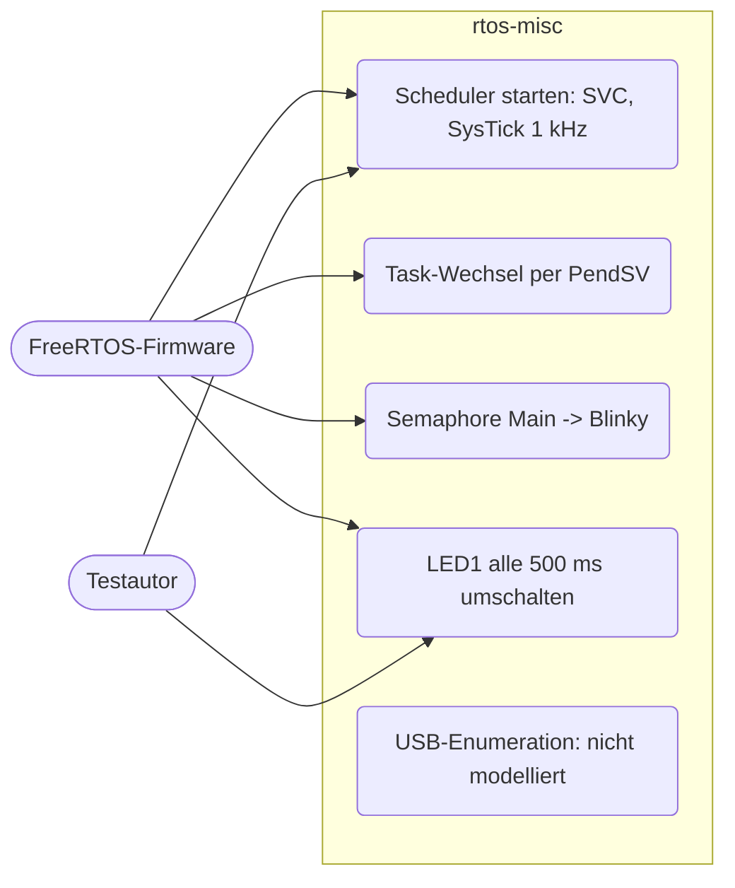
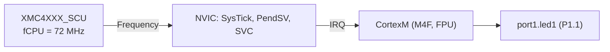
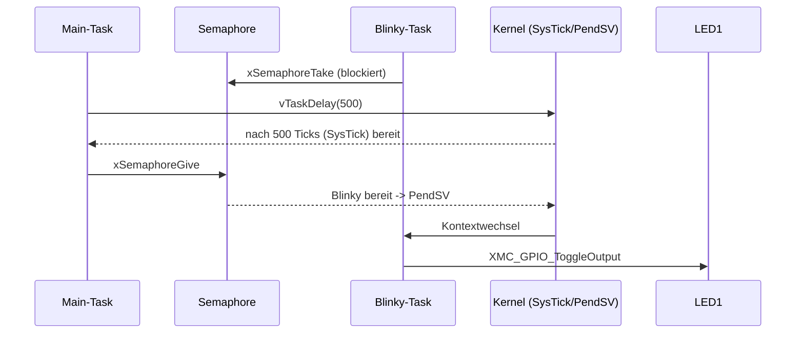
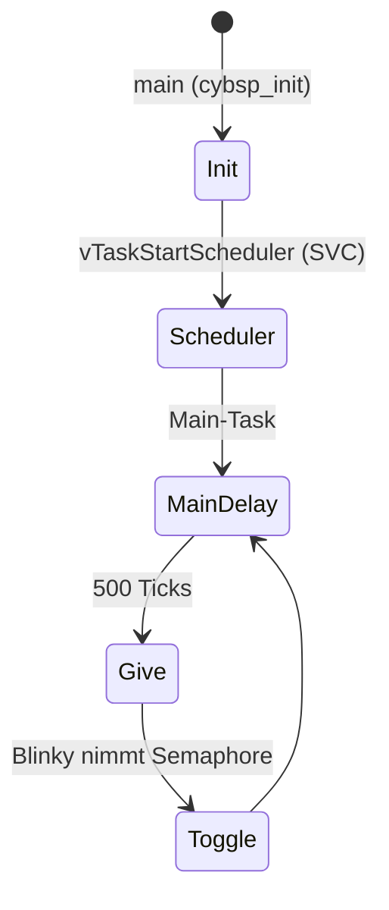

# FreeRTOS und USB (`rtos-misc`)

> FreeRTOS-Lauf auf dem Cortex-M4F (SysTick, PendSV, Semaphore) für `FreeRTOS_Blinky`; Analyse, warum das USB0-Gerät (`emUSB-Device_HID_Generic`) nicht modelliert wird.

Referenz: Reference Manual v1.6, Kapitel "Universal Serial Bus (USB)" (USB0, OTG-Kern), Cortex-M4 Generic User Guide (SysTick, PendSV). Beispiele: `FreeRTOS_Blinky`, `emUSB-Device_HID_Generic`.

## 1. Use Cases



## 2. Aufbau

Für FreeRTOS wird **kein neues Peripheral** gebraucht; benutzt werden nur vorhandene Teile.



| Teil | Verhalten |
|---|---|
| SysTick | `systickFrequency` wird von der SCU auf fCPU gesetzt; Firmware: `SystemCoreClock = 72 MHz`, `configTICK_RATE_HZ = 1000`, Reload = 72000 - 1 |
| PendSV / SVC | von Renodes NVIC/CortexM bereitgestellt (Kontextwechsel inkl. FPU-Lazy-Stacking, `EXC_RETURN`) |
| Priorität | `configKERNEL_INTERRUPT_PRIORITY = 63 << 2 = 0xFC`; 6 Prioritätsbits |

Beim Start schreibt der FreeRTOS-Port 0xFF in das Prioritätsregister von IRQ0, um die Zahl der Prioritätsbits zu ermitteln. Der NVIC meldet dabei `Trying to set the priority for interrupt 16 to 0xFF ...`; das ist harmlos (Rücklesen liefert 0xFC wie in Hardware).

## 3. Verhalten





Gemessen: `SystemCoreClock` = 72000000, `xTickCount` wächst um 2001 in 2 s (1 kHz), LED1 wechselt alle 500 ms. Die Firmware benötigt ca. 0,23 virtuelle Sekunden bis zum Scheduler-Start (Takt-Setup), daher steht `xTickCount` nach 1,0 s bei etwa 767.

## 4. USB0 (`emUSB-Device_HID_Generic`): Analyse und Entscheidung

Entscheidung: **nicht modelliert, Test mit `[Tags] skip`**.

Befund im Renode-Submodul (`Peripherals/USB`): `USBHost`, `USBKeyboard`, `USBMouse`, `USBPendrive`, `CDCToUARTConverter` (Gerätemodelle/Host-Seite), `MPFS_USB`, `NRF_USBD`, `ValentyUSB` (andere Controller). Es gibt **keine** Synopsys-DWC_otg/DWC2-Klasse (die Suche nach `dwc`/`otg` findet nur Ethernet-Modelle). Der Controller USB0 des XMC4500 ist ein DWC_otg-artiger OTG-HS-Kern (Registerblock ab `0x50040000`, Endpunkte ab `0x50040900`, 0x50040800 = Device-Konfiguration/DCFG).

Was nötig wäre:

1. Neues Peripheral `XMC4XXX_USB0` (DWC_otg, Device-Modus): Global-Register (GAHBCFG, GUSBCFG, GRSTCTL, GINTSTS/GINTMSK, GRXSTSP, GRXFSIZ, GNPTXFSIZ, DIEPTXFn), Device-Register (DCFG, DCTL, DSTS, DIEPMSK/DOEPMSK, DAINT/DAINTMSK), je Endpunkt DIEPCTL/DIEPINT/DIEPTSIZ/DTXFSTS und DOEPCTL/DOEPINT/DOEPTSIZ, die Daten-FIFOs (0x50041000 + n*0x1000), Reset-/Enumeration-Ereignisse (USBRST, ENUMDNE), Slave- und optional DMA-Modus, SETUP-Pakete über den RX-FIFO, NAK/STALL, Transfergrößen-Zähler. Dazu USB-Taktung im SCU (USB-PLL: Status wurde hier ergänzt) und das Power-Gating (`PWRSET.USBPHYPD/USBOTGEN`, Reset `PRSET2.USBRS`).
2. Host-Seite: Renodes `USBHost` kann an ein Gerät gebunden werden, aber nur für Renode-eigene Controller (`IUSBDevice`/`USBConnector`); das Modell müsste das Gerät in Gegenrichtung als Host-Endpunkt anbieten und ein Test müsste Control-Transfers (GET_DESCRIPTOR, SET_ADDRESS, SET_CONFIGURATION, HID-Report-Deskriptor) und Interrupt-Transfers ausführen.
3. Die Firmware benutzt SEGGER emUSB-Device als **Objektcode-Bibliothek** (nur `usbd_config.c` und Header liegen als Quelle vor). Welche Registerreihenfolge und welche Timing-Annahmen der Treiber hat, ist nur aus Disassembly zu erfahren; jeder unmodellierte Bit-Handshake (z. B. `GRSTCTL.CSRST`, `AHBIDL`, FIFO-Flush) lässt die Firmware hängen.

Aufwand: Schätzung 1500 bis 2500 Zeilen C# für ein tragfähiges Device-Modell plus Host-Treiber im Test sowie mehrere Tage Iteration gegen die nicht quelloffene Bibliothek; ohne Referenzimplementierung in Renode (alle DWC2-Modelle fehlen) und ohne beobachtbaren Nutzen für die anderen Komponenten. Das ist für diese Plattform unverhältnismäßig.

Stand der Firmware im Modell: Nach der SCU-Ergänzung (USB-PLL-Status aus `USBPLLCON`, vorher hing `XMC_SCU_CLOCK_StartUsbPll` in einer Pollschleife) läuft die Firmware bis zum ersten Zugriff auf USB0 (`0x50040800` DCFG, `0x50040018`, `0x50040038`, `0x50040834`) und meldet `non existing peripheral`; danach folgt die Stack-Initialisierung ohne Gerätereaktion.

Alternativen:

- Nur die Init-Phase testen (USB-PLL, Aufruf von `USBD_Init`): kein UART-Text, da `printf` erst nach der Taktkonfiguration kommt und die Ausgabe vom USB-Treiber nicht abhängt; Aussagekraft gering.
- Minimal-Stub für USB0 (Register als RAM, Statusbits sofort fertig), damit die Firmware bis `USBD_Start` kommt und `APP_LOG`-Zeilen ausgibt. Das wäre ein ehrlicher Teilschritt, bildet aber keine Enumeration ab und wurde nicht umgesetzt.
- Externe Co-Simulation (z. B. Renode mit USB/IP oder ein Hardware-in-the-loop-Test auf dem echten Kit).

## 5. Vereinfachungen und bekannte Lücken

- Kein USB0-Modell; `emUSB-Device_HID_Generic` bleibt offen (Test übersprungen).
- Der Start des FreeRTOS-Beispiels erzeugt eine Warnung: NVIC-Prioritätsprobe (siehe oben, harmlos).

## 6. Manuell nachvollziehen

```bash
scripts/xmc4500/run-example.sh FreeRTOS_Blinky 0 "emulation RunFor '0.3'; sysbus.port1.led1 State; emulation RunFor '0.5'; sysbus.port1.led1 State"
# erwartet: False, danach True (LED1 wechselt alle 500 ms)
scripts/xmc4500/run-example.sh FreeRTOS_Blinky 0 "emulation RunFor '1'; sysbus ReadDoubleWord 0x20000854"
# xTickCount (Adresse aus 'arm-none-eabi-nm') ~ 767, nach 2 weiteren Sekunden +2000
```

## 7. Tests

Datei: `tests/platforms/xmc4500/rtos-misc.robot`, Start: `scripts/xmc4500/test.sh rtos-misc`.

| Test-Case | Beispiel | Prüft |
|---|---|---|
| Should Toggle LED Every 500 ms From FreeRTOS Tasks | `FreeRTOS_Blinky` | LED1 an/aus je 0,5 s (SysTick, PendSV, Semaphore) |
| Should Run FreeRTOS Tick At 1 kHz | `FreeRTOS_Blinky` | `SystemCoreClock` = 72 MHz, Scheduler läuft, `xTickCount` +2000 in 2 s |
| Should Enumerate As USB HID Device | `emUSB-Device_HID_Generic` | übersprungen (`skip`): USB0 nicht modelliert |
