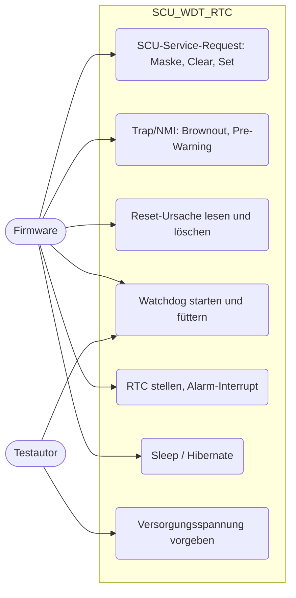
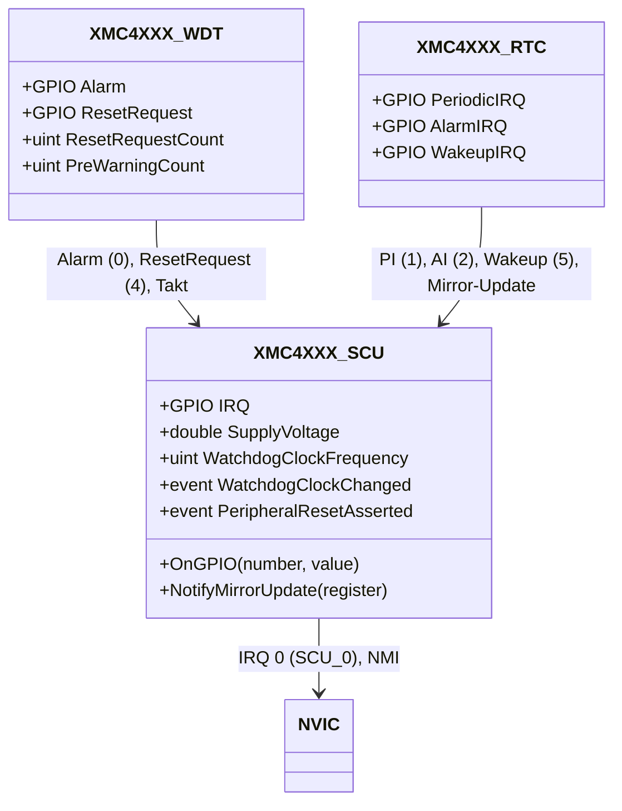
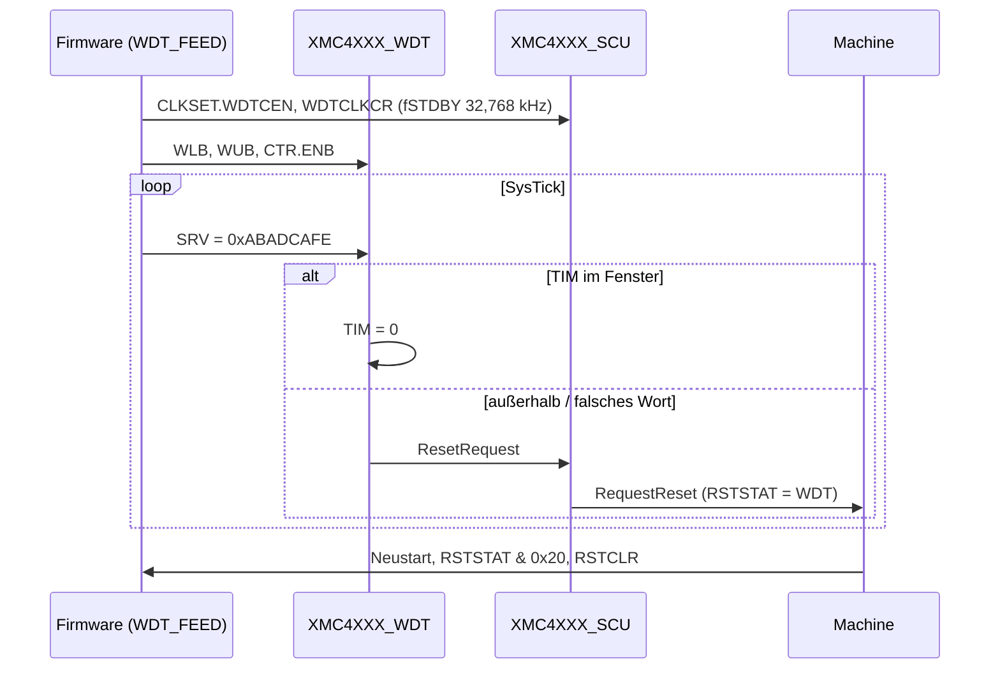
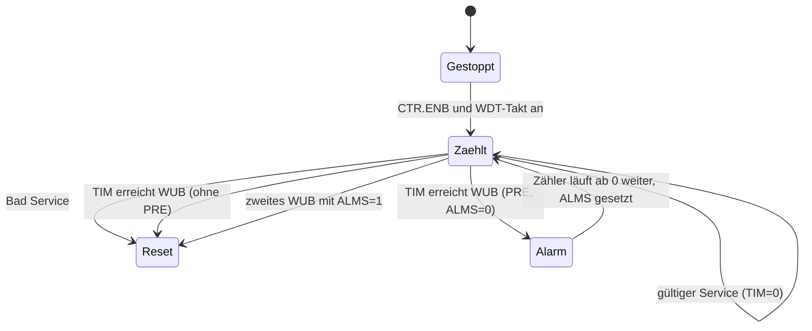
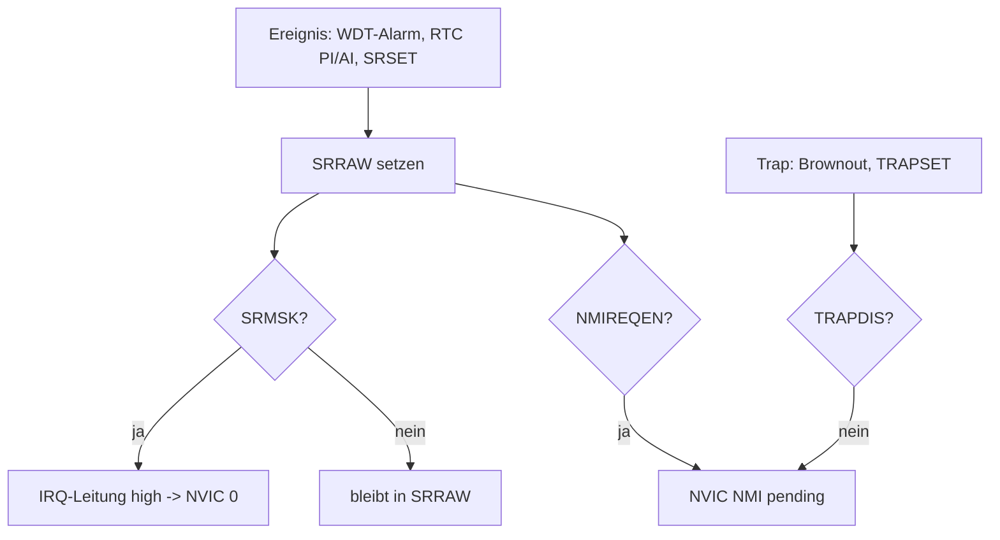

# SCU, Watchdog und RTC (`scu-wdt-rtc`)

> Vervollständigt die System Control Unit (Interrupts, Traps, Power/Hibernate, Reset, Takt) und ergänzt den Window Watchdog (WDT) sowie die Hibernate-Domain-RTC des XMC4500 für die Beispiele `SCU_Sleep`, `Brownout_Detection`, `WDT_FEED`, `WDT_Prewarning`, `RTC_Alarm`, `Empty_XMC_App`.

Referenz: Reference Manual v1.6, Kapitel 9 "Window Watchdog Timer (WDT)", Kapitel 10 "Real Time Clock (RTC)", Kapitel 11 "System Control Unit (SCU)"; Registerlayout gegen `XMC4500.h` geprüft. Beispiele: `SCU_Sleep`, `Brownout_Detection`, `WDT_FEED`, `WDT_Prewarning`, `RTC_Alarm`, `Empty_XMC_App`.

## 1. Use Cases



## 2. Aufbau



Eingänge des SCU (`OnGPIO`): 0 WDT-Prewarning, 1 RTC periodisch, 2 RTC Alarm, 3 DLR-Overrun, 4 WDT-Reset-Anforderung, 5 RTC-Wakeup, 6/7 Hibernate-Wakeup-Pin (pos./neg. Flanke), 16-19 ERU0-Ausgänge 0-3 (NMI-Promotion über NMIREQEN).

Registerübersicht SCU (Offset ab 0x50004000; SCU belegt nur `0x50004000 .. 0x500047FF`, damit ERU0/DLR/RTC darüber liegen können):

| Offset | Register | Verhalten |
|---|---|---|
| 0x000-0x010 | ID, IDCHIP, IDMANUF, STCON | feste Werte, SWCON speicherbar |
| 0x02C/0x030, 0x04C | GPR0/1, CCUCON | Speicher |
| 0x074-0x088 | SRSTAT, SRRAW, SRMSK, SRCLR, SRSET, NMIREQEN | SRSTAT = SRRAW & SRMSK; IRQ-Leitung (NVIC 0) ist der Pegel von SRSTAT != 0; NMIREQEN befördert PRWARN/PI/AI zum NMI |
| 0x0C4 | MIRRSTS | immer 0 (Spiegel-Updates sofort fertig); in SRRAW werden die Update-Bits (HDCLR..RTC_TIM1) gesetzt |
| 0x13C-0x158 | Parity-Register | Speicher, keine Parity-Fehler |
| 0x160-0x170 | TRAPSTAT, TRAPRAW, TRAPDIS (Reset 0x1FF), TRAPCLR, TRAPSET | Trap -> NMI; BRWNT (Bit 5) vom Brownout-Monitor |
| 0x200-0x22C | PWRSTAT/PWRSET/PWRCLR, EVRSTAT, EVRVADCSTAT, PWRMON | HIBEN; VADC33V = VDDP/22,5 mV + 1; PWRMON vergleicht einmalig und bei Spannungsänderung (INTV ohne Zeitwirkung) |
| 0x300-0x31C | HDSTAT, HDCLR (0x304), HDSET (0x308), HDCR, OSCSICTRL, OSCULSTAT, OSCULCTRL | Hibernate-Domain, überlebt WDT-Reset; HDCR.HIB hält die CPU an, ein freigegebenes Wakeup löst System-Reset mit HIBWK aus |
| 0x400-0x438 | RSTSTAT/RSTSET/RSTCLR, PRSTAT0-3/PRSET/PRCLR | Reset-Ursache (PORST 0x01, WDT 0x20) klebt über WDT-Reset und wird mit RSTCLR.RSCLR gelöscht; PRSTAT mit Reset-Werten aus dem RM, PRSET2.WDTRS setzt den WDT zurück |
| 0x600-0x634 | CLKSTAT/CLKSET/CLKCLR, SYSCLKCR..EXTCLKCR, SLEEPCR (0x630), DSLEEPCR (0x634) | Teiler gespeichert, SysTick-Frequenz abgeleitet; SLEEP/DSLEEPCR nur gespeichert (WFI/Deep-Sleep behandelt der CPU-Kern) |
| 0x700-0x738 | OSCHP*, PLLSTAT/PLLCON0-2, USBPLL*, CLKMXSTAT | Lock/Bypass aus Kontrollbits, K1RDY/K2RDY Bit 4/5 |

WDT (`0x50008000`): ID, CTR (ENB, PRE, DSP, SPW), SRV (Magic Word 0xABADCAFE), TIM, WLB, WUB, WDTSTS (ALMS), WDTCLR (ALMC).
RTC (`0x50004A00`): ID, CTR (ENB, TAE, E*C, DIV), RAWSTAT, STSSR, MSKSR, CLRSR, ATIM0/1, TIM0/1.

Einbindung (`platforms/cpus/xmc4500.repl`):

```
scu: Miscellaneous.XMC4XXX_SCU @ sysbus <0x50004000, +0x800>
    nvic: nvic
    IRQ -> nvic@0
wdt: Timers.XMC4XXX_WDT @ sysbus 0x50008000
    scu: scu
    Alarm -> scu@0
    ResetRequest -> scu@4
rtc: Timers.XMC4XXX_RTC @ sysbus 0x50004A00
    scu: scu
    PeriodicIRQ -> scu@1
    AlarmIRQ -> scu@2
    WakeupIRQ -> scu@5
```

## 3. Verhalten





Service Requests und NMI:



## 4. Vereinfachungen und bekannte Lücken

- **Beispiel-Fenster passen nicht zur Firmware**: `WDT_FEED`/`WDT_Prewarning` stellen fWDT auf den 32,768-kHz-Standby-Takt, die Fenstergrenzen (6 s..7 s bei 120 MHz) sind aber riesig. Die erste Fütterung nach 1 s ist daher ein Bad Service; das Modell verhält sich wie im Reference Manual beschrieben (Reset, danach schnelles Blinken). Die Tests öffnen das Fenster per Monitor (WLB = 0, WUB = 5 s).
- Pre-Warning: nach dem ersten Überschreiten von WUB läuft der Zähler ab 0 weiter (Annahme, das RM beschreibt nur "second overflow"). Service-Indikation (wdt_service) und CTR.DSP nicht modelliert.
- Der Reset-Grund eines Software-Resets (SYSRESETREQ) wird nicht unterschieden, jeder andere Reset gilt als PORST.
- Brownout: Vergleich einmalig bei PWRMON-Schreiben und bei Änderung von `SupplyVoltage`, nicht periodisch alle INTV Takte. Oscillator-Watchdog-, VCO-Lock- und Parity-Traps werden nicht erzeugt.
- Hibernate: CPU wird angehalten, Wakeup löst System-Reset aus (RAM bleibt erhalten, anders als in Hardware). Nicht durch ein Beispiel genutzt, nicht getestet.
- Sleep/Deep Sleep: SLEEPCR/DSLEEPCR nur gespeichert; Aufwachen aus WFI übernimmt der CPU-Kern.
- RTC: Takt fest 32,768 kHz (fOSI = fULP), keine Reset-Gating der Hibernate-Domain; TIM0/TIM1 nur bei ENB=0 schreibbar.
- Peripherie-Reset (PRSTATn) blockiert keine Registerzugriffe; Clock-Gating (CGAT) existiert beim XMC4500 nicht und wurde aus dem Basismodell entfernt.

Korrekturen am Basismodell (gegen `XMC4500.h`/RM): HDSET/HDCLR waren vertauscht (0x304 = HDCLR, 0x308 = HDSET), SLEEPCR/DSLEEPCR liegen bei 0x630/0x634 (nicht 0x62C), PLLSTAT.K1RDY/K2RDY sind Bit 4/5 (nicht 5/6), USBPLLCON-Reset 0x00010003, OSCHPCTRL-Reset 0x3C, Prescaler-Modus (VCOBYP=1) nutzt K1DIV.

## 5. Manuell nachvollziehen

```bash
scripts/xmc4500/run-example.sh WDT_FEED 0 "logLevel -1 sysbus.wdt; emulation RunFor '1.5'; sysbus.port1.led1 State"
# erwartet: "Bad service ... below the window lower bound", "Watchdog reset requested"
scripts/xmc4500/run-example.sh Brownout_Detection 0 "emulation RunFor '0.1'; sysbus.scu SupplyVoltage 2.8; emulation RunFor '0.1'; sysbus ReadDoubleWord 0x50004164"
# erwartet: 0x20 (BRWNT), LED1 umgeschaltet durch NMI_Handler
scripts/xmc4500/run-example.sh RTC_Alarm 0 "emulation RunFor '61'; sysbus ReadDoubleWord 0x50004A08"
# erwartet: Bit 8 (RAI) gesetzt, LED1 dauerhaft an
```

## 6. Tests

Datei: `tests/platforms/xmc4500/scu-wdt-rtc.robot`, Start: `scripts/xmc4500/test.sh scu-wdt-rtc` (ca. 4 min, `RTC_Alarm` simuliert 61 s).

| Test-Case | Beispiel | Prüft |
|---|---|---|
| Should Wake Up From Sleep On Interrupt | `SCU_Sleep` | LED1 ändert sich nach NVIC-Interrupt 5 (ERU1_0, injiziert; ERU ist andere Komponente) |
| Should Enter NMI On Brownout | `Brownout_Detection` | `SupplyVoltage 2.8` setzt TRAPRAW.BRWNT, NMI-Handler schaltet LED1 |
| Should Not Raise Brownout At Nominal Supply | `Brownout_Detection` | 3,2 V löst nichts aus |
| Should Reset On Bad Watchdog Service | `WDT_FEED` | Bad Service nach 1 s, Reset, LED1 blinkt schnell (Reset-Ursache WDT) |
| Should Keep Running When Watchdog Is Fed And Reset When Feeding Stops | `WDT_FEED` | mit offenem Fenster 10 Fütterungen ohne Reset, dann Timeout-Reset |
| Should Raise Watchdog Prewarning Before Reset | `WDT_Prewarning` | PRWARN -> NMI -> LED2, ALMS=1, danach Reset |
| Should Trigger RTC Alarm After One Minute | `RTC_Alarm` | bei 59 s kein Alarm, bei 60 s RAI, LED1 bleibt an |
| Should Boot Empty Application Without Unhandled SCU Accesses | `Empty_XMC_App` | TRAPCLR & Co. behandelt |
