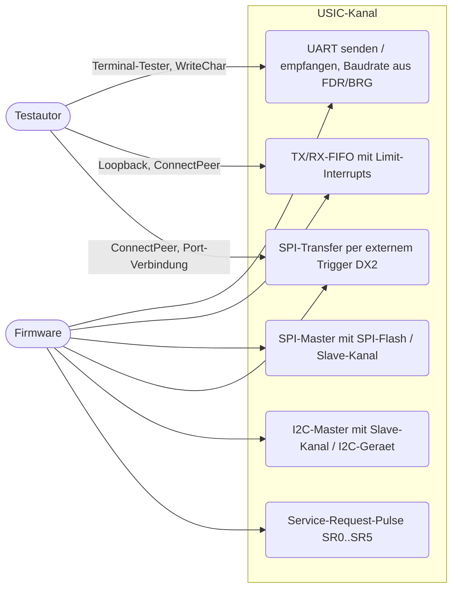
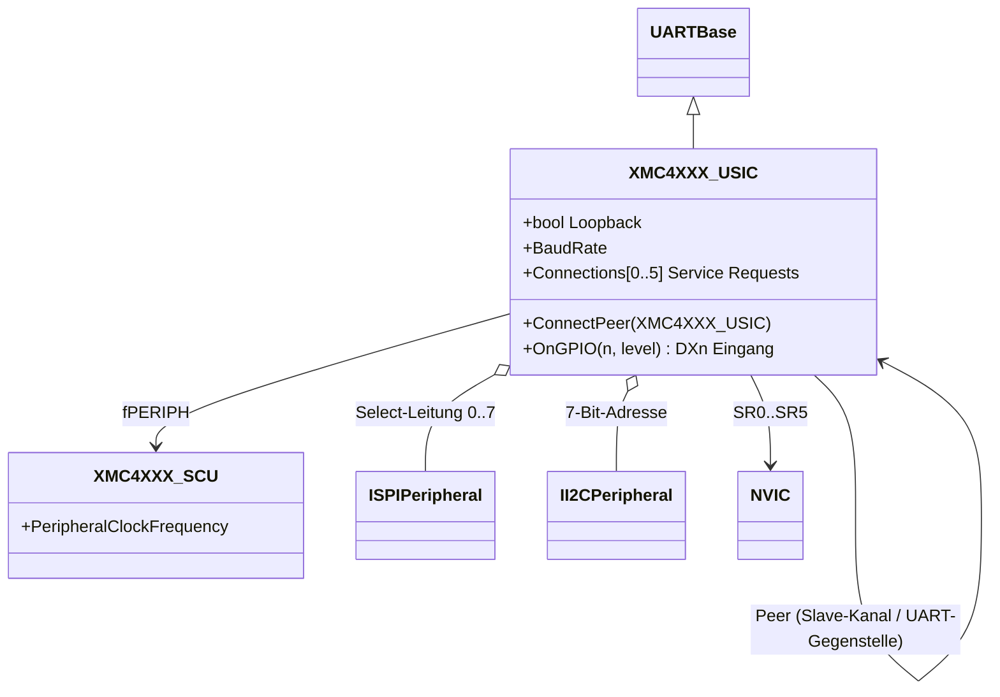
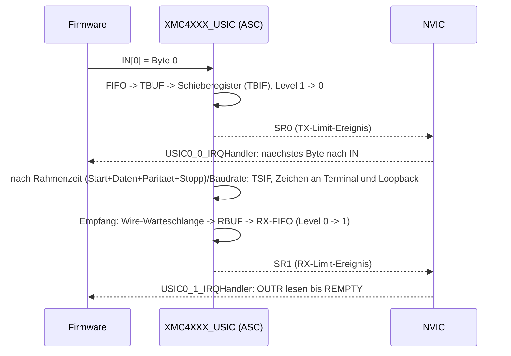
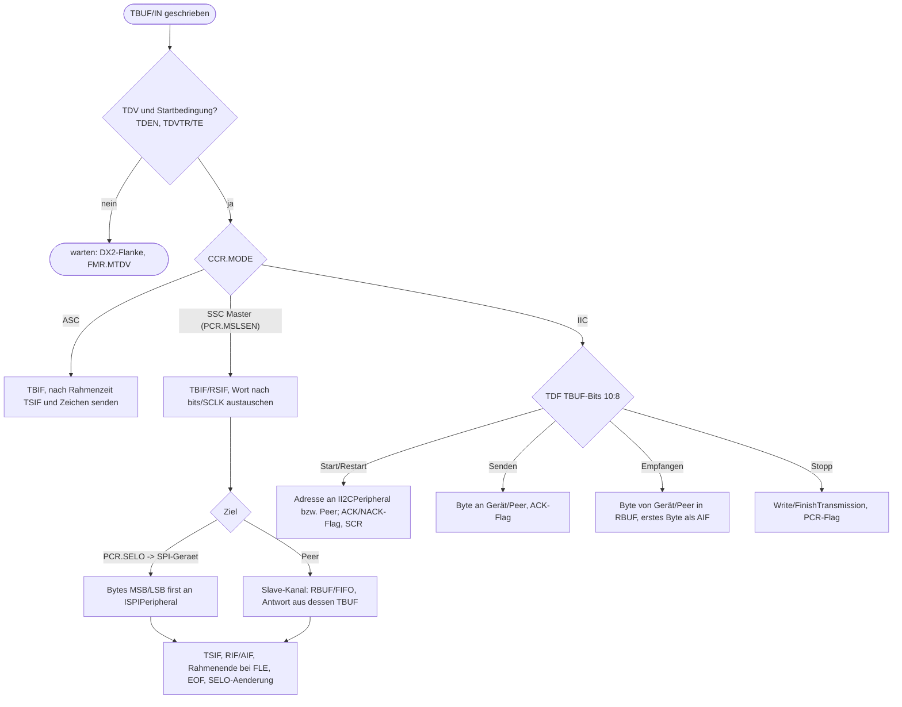

# USIC-Kanal: UART, SPI, I2C (`usic`)

> Ein universeller Kanal `XMC4XXX_USIC` bildet je nach `CCR.MODE` das UART- (ASC), SPI- (SSC) oder I2C-Protokoll (IIC) eines USIC-Kanals des XMC4500 nach; sechs Instanzen (USIC0..2, je Kanal 0/1).

Referenz: Reference Manual v1.6, Kapitel 17 "Universal Serial Interface Channel (USIC)". Beispiele: `UART_Printf`, `UART_Transmit`, `UART_Transmit_Receive_FIFO_Interrupts`, `SPI_Master`, `SPI_EXTTRG_transmit`, `SPI_QSPI_Flash`, `I2C_Master_and_Slave` (`UART_DMA` und `SPI_DMA` gehören zu `dma-fce`).

## 1. Use Cases



## 2. Aufbau

Entscheidung: **eine** Kanalklasse (Protokoll nach `CCR.MODE`), weil Register, Puffer, FIFO und Interrupts aller Protokolle identisch sind und die Firmware den Modus zur Laufzeit wechseln darf (QSPI-Beispiel). Der Instanzname `usic0ch0` und die UART-Tester-Nutzung bleiben unveraendert. Dateien: `XMC4XXX_USIC.cs` (Register, Puffer, FIFO, Interrupts, ASC), `XMC4XXX_USIC_SSC.cs`, `XMC4XXX_USIC_IIC.cs` (partielle Klasse).



| Instanz | Adresse | NVIC (SR0..SR5, je Modul von beiden Kanälen geteilt) |
|---|---|---|
| `usic0ch0`, `usic0ch1` | 0x40030000, 0x40030200 | 84-89 |
| `usic1ch0`, `usic1ch1` | 0x48020000, 0x48020200 | 90-95 |
| `usic2ch0`, `usic2ch1` | 0x48024000, 0x48024200 | 96-101 |

Registerübersicht (alle Register des Kanals sind modelliert; Verhalten im Modell):

| Offset | Register | Verhalten |
|---|---|---|
| 0x04 | CCFG | 0xCF (SSC, ASC, IIC, IIS, FIFOs) |
| 0x0C-0x14 | KSCFG, FDR, BRG | gespeichert; FDR/BRG bestimmen Baudrate bzw. SCLK (Normal- und Bruchmodus) |
| 0x18 | INPR | Knotenzeiger TSINP, TBINP, RINP, AINP, PINP |
| 0x1C-0x30 | DX0CR..DX5CR | DSEL (6 = Eigen-Loopback, 7 = konstant 1), DPOL, CM (Flanke an DX2), DXS |
| 0x34 | SCTR | SDIR, PDL, DSM, TRM, FLE, WLE |
| 0x38 | TCSR | WLEMD/FLEMD/SELMD/HPCMD (TCI aus TBUF-/IN-Index), SOF, EOF, TDV, TDSSM, TDEN, TDVTR, TE |
| 0x3C | PCR | modusabhaengig: ASC (STPB), SSC (MSLSEN, SELO, DX2TIEN, MSLSIEN), IIC (SLAD, ACK00, Interrupt-Freigaben) |
| 0x40 | CCR | MODE, PM (Paritaet), Ereignis-Freigaben RSIEN/DLIEN/TSIEN/TBIEN/RIEN/AIEN |
| 0x48/0x4C | PSR / PSCR | Ereignis-Flags (RSIF..AIF) und Protokollbits je Modus; PSCR loescht |
| 0x50-0x64 | RBUFSR, RBUF, RBUFD, RBUF0/1, RBUF01SR | zweistufiger Empfangspuffer (aelteste zuerst), DLIF bei Ueberlauf |
| 0x68 | FMR | MTDV (TDV/TE), CRDV, SIO0..SIO5 loesen SR0..SR5 aus |
| 0x80-0xFC / 0x180-0x1FC | TBUF[n] / IN[n] | n = TCI; IN geht ueber die TX-FIFO, TBUF direkt |
| 0x108-0x120 | TBCTR, RBCTR, TRBPTR, TRBSR, TRBSCR, OUTR, OUTDR | FIFOs (Groesse 2^SIZE), Limit-Ereignisse (LOF, STBTEN/SRBTEN, Trigger-Modus), RCI-Modus, Fehlerereignisse, Fuellstand, Zeiger |

Einbindung (`platforms/cpus/xmc4500.repl`):

```
usic0ch0: UART.XMC4XXX_USIC @ sysbus <0x40030000, +0x200>
    scu: scu
    [0-5] -> nvic@[84-89]
```

Auf dem Board (`xmc4500_relax_lite_kit.repl`) haengt der 32-Mbit-SPI-Flash S25FL032P als `SPI.GenericSpiFlash` an `usic0ch0` (Select-Leitung 1).

## 3. Verhalten

Alle Ereignisse erzeugen einen **Puls** (Blink) auf der per INPR/TBCTR/RBCTR gewaehlten Service-Request-Leitung, unabhaengig vom Zustand des Flags (wie in Abschnitt 17.2.2.3 beschrieben).

UART mit TX-FIFO und RX-FIFO (`UART_Transmit_Receive_FIFO_Interrupts`, TX mit RX verbunden durch `Loopback`):



SPI (SSC) und I2C (IIC):



## 4. Vereinfachungen und bekannte Lücken

- **Pins/Pad-Routing nicht modelliert**: Verbindungen entstehen direkt. UART: `Loopback` (TX an eigenen RX, ersetzt die Drahtbruecke) oder `ConnectPeer`; SPI/I2C: `ConnectPeer` an den Slave-Kanal bzw. Geraet am Master registriert (`@ usic0ch0 <Select-Leitung>` fuer SPI, `<7-Bit-Adresse>` fuer I2C). DX2 ist per `OnGPIO` Eingang 2 erreichbar (`port0: 12 -> usic1ch1@2`).
- Zeitverhalten: ASC (Rahmenzeit aus FDR/BRG und SCU-Takt `fPERIPH = fCPU/(PBDIV+1)`) und SSC-Wortzeit (`bits/fSCLK`) sind zeitrichtig; I2C-Symbole dauern keine Zeit.
- ASC: keine Rahmen-/Paritätsfehler bei Empfang, kein Sync-Break/LIN, 9-Bit-Daten werden auf 8 Bit gekuerzt (`IUART` ist byteweise). Empfang ist nur im Modus ASC aktiv.
- SSC: Dual/Quad werden nur als Bitstrom behandelt (`SCTR.DSM`, `TCSR.HPCMD` gespeichert); Rahmenende bei `FLE < 63` Bits, `TCSR.EOF` oder Aenderung von `PCR.SELO`; `FLE = 63` gilt als unbegrenzt, das Ende "TBUF leer" (`PCR.FEM = 0`) und die Slave-Select-Verzoegerungen werden nicht modelliert. SELCTR (codierter Select) und Paritaet im SSC fehlen. Ohne angeschlossenes Geraet liefert der Master 0 (DSEL = 6: eigenes Datenwort).
- SSC-Slave: Wort kommt vom Master des `Peer`, Wortlaenge des Masters, Antwort aus TBUF (bei `TDSSM = 0` wiederholt) oder `SCTR.PDL`.
- IIC: ein Master pro Bus, kein Arbitrierungsverlust, kein 10-Bit-Adressmodus, Slave-Senden nur mit vorab geladenem TDF-1-Wort (der SRR-Interrupt kommt zu spaet fuer eine synchrone Antwort). `TCSR.TDSSM = 0` wird wie Einzelschuss behandelt.
- Bypass (BYP/BYPCR), Capture-Mode-Timer, MCLK/SCLK-Pins, IIS sind nur gespeicherte Register oder fehlen.
- Zugriffe der FIFOs: TBUF-Schreiben bei aktiver FIFO geht direkt in TBUF (kein Zusammenspiel mit der FIFO).
- Befunde am Vorgänger-Modell (`XMC4XXX_UART`), jetzt korrigiert: BRG-Felder SCLKOSEL/MCLKCFG/SCLKCFG lagen falsch, FMR.CRDV0/1 standen auf Bit 8/9 statt 14/15, der Normal-Teilermodus (`FDR.DM = 1`) rechnete mit STEP/1024 statt 1/(1024-STEP), Service Requests waren Pegel statt Pulse, die Baudrate kam aus einem festen Konstruktorparameter (120 MHz statt 72 MHz Peripherietakt).

## 5. Manuell nachvollziehen

```bash
scripts/xmc4500/run-example.sh UART_Printf 1
# Ausgabe "Hello World!" auf usic0ch0 (115200 Baud aus FDR/BRG), Baudrate im Monitor: usic0ch0 BaudRate
scripts/xmc4500/run-example.sh SPI_Master 0 "usic1ch0 ConnectPeer usic2ch0; sysbus WriteDoubleWord 0x48024034 0x07000100; sysbus WriteDoubleWord 0x4802410C 0x03000000; sysbus WriteDoubleWord 0x48024040 1; emulation RunFor '1.1'; sysbus ReadDoubleWord 0x48024114"
# TRBSR des Slave-Kanals: Fuellstand 3 in Bits 22:16; OUTR (0x4802411C) liefert 0x84 0x0F 0x84
```

## 6. Tests

Datei: `tests/platforms/xmc4500/usic.robot`, Start: `scripts/xmc4500/test.sh usic`.

| Test-Case | Beispiel | Prüft |
|---|---|---|
| UART Printf | `UART_Printf` | Ausgabe auf `usic0ch0`, Baudrate 115000-115400 aus FDR/BRG |
| UART Transmit | `UART_Transmit` | zyklische Meldung auf `usic1ch1` |
| UART Receive Through RBUF And Interrupt Flags | `UART_Printf` | Zeichen per Tester landet in RBUF, `PSR.RIF` |
| UART Transmit Receive With FIFOs And Interrupts | `UART_Transmit_Receive_FIFO_Interrupts` | TX-/RX-FIFO, SR0/SR1, LED nach 9 Bytes (Loopback) |
| SPI Master Sends Three Words To A Slave Channel | `SPI_Master` | Master `usic1ch0` -> Slave `usic2ch0` (RX-FIFO), 0x84 0x0F 0x84 |
| SPI Transfer Starts On External Trigger | `SPI_EXTTRG_transmit` | Worte erst nach DX2-Flanke (P0.12), 16-Bit-Worte |
| SPI QSPI Flash Erase Program And Read Back | `SPI_QSPI_Flash` | Löschen, Programmieren, Lesen und Vergleich am S25FL032P |
| I2C Master Controls LED Through Slave Channel | `I2C_Master_and_Slave` | Master -> Slave (Adresse 5), Slave-Interrupt schaltet die LED |
