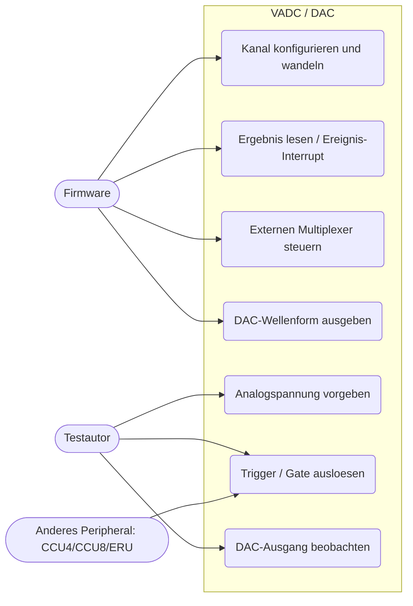
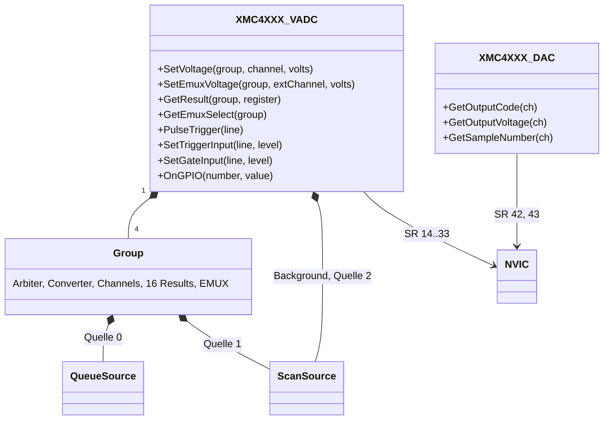
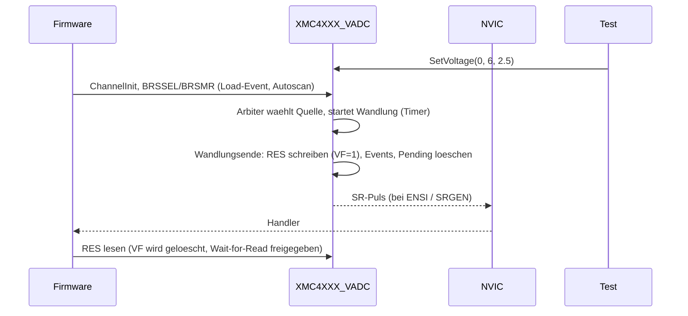
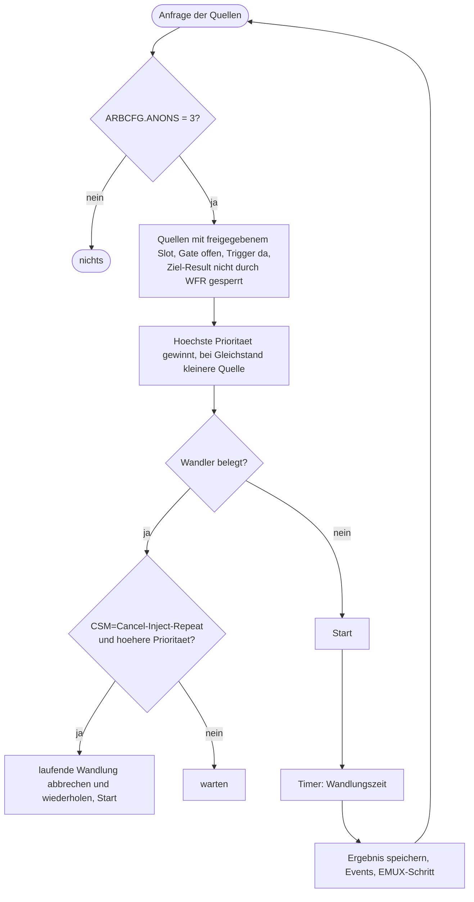

# VADC und DAC (`vadc-dac`)

> Nachbildung des Versatile ADC (4 Gruppen, Queue-/Scan-/Background-Quelle, EMUX) und des 2-Kanal-DAC der XMC4500 für die Beispiele `VADC_Background`, `VADC_Scan`, `VADC_Queue`, `VADC_EMUX` und `DAC_Sine_Wave`.

Referenz: Reference Manual v1.6, Kapitel 19 "Versatile Analog-to-Digital Converter (VADC)" und Kapitel 21 "Digital to Analog Converter (DAC)". Beispiele: `VADC_Background`, `VADC_Scan`, `VADC_Queue`, `VADC_EMUX`, `DAC_Sine_Wave`, `CCU8_TRIGGERED_VADC_MEASUREMENT` (wartet auf CCU8).

## 1. Use Cases



## 2. Aufbau



Einbindung in `platforms/cpus/xmc4500.repl`:

```
vadc: Analog.XMC4XXX_VADC @ sysbus <0x40004000, +0x1400>
    nvic: nvic
    [0-15] -> nvic@[18-33]
    [16-19] -> nvic@[14-17]

dac: Analog.XMC4XXX_DAC @ sysbus 0x48018000
    nvic: nvic
    [0-1] -> nvic@[42-43]
```

GPIO-Ausgaenge VADC: 0-15 = G0SR0..G3SR3, 16-19 = C0SR0..C0SR3 (gemeinsame Leitungen, Knotenzeiger 4-7 bzw. GLOBEVNP 0-3), 20-25 = EMUX-Steuerleitungen Schnittstelle 0/1. GPIO-Eingaenge VADC: 0-15 = Trigger A..P (REQTRx), 16-31 = Gate A..P (REQGTx); sie gelten fuer alle Quellen und Gruppen gleichzeitig (Vereinfachung gegenueber Tabelle 19-13). Eingaenge DAC: 0-7 = externe Trigger (TRIGSEL).

Test-Schnittstelle (Monitor):

| Aufruf | Wirkung |
|---|---|
| `sysbus.vadc SetVoltage <gruppe> <kanal> <volt>` | Eingangsspannung (Referenz 3,3 V); Wandlung liefert `floor(U/3,3*4096)` begrenzt auf 0..4095, reduziert auf 10/8 Bit je Input-Klasse |
| `sysbus.vadc SetEmuxVoltage <gruppe> <ext.kanal 0-7> <volt>` | Spannung hinter dem externen Multiplexer (gilt fuer EMUX-Kanal, Auswahl nach EMUXACT) |
| `sysbus.vadc PulseTrigger <0-15>` / `SetTriggerInput` / `SetGateInput` | Trigger- und Gate-Eingaenge treiben |
| `sysbus.vadc GetResult <gruppe> <reg>` / `GetEmuxSelect <gruppe>` | Ergebnis ohne Valid-Flag zu loeschen / EMUX-Code |
| `sysbus.dac GetOutputCode/GetOutputValue/GetOutputVoltage <kanal>`, `Output0Voltage` ... | DAC-Ausgang (Code 0..4095, bei SIGN=1 um 2048 verschoben; U = Code*3,3/4096; 0 V im Standby) |
| `sysbus.dac GetSampleNumber <kanal>` | Anzahl Trigger seit Modusstart (Pattern: Ausgabe ist Sample n-1) |

Registerabdeckung VADC (Offsets Gruppe x: `0x400*(x+1)+...`): CLC, ID, OCS, GLOBCFG (SUCAL sofort fertig), GLOBICLASS0/1, GLOBBOUND, GLOBEFLAG, GLOBEVNP, GLOBTF, BRSSEL/BRSPND/BRSCTRL/BRSMR, GLOBRCR, GLOBRES(D), EMUXSEL; je Gruppe ARBCFG, ARBPR, CHASS, ICLASS0/1, ALIAS, BOUND, SYNCTR (nur gespeichert), BFL/BFLS/BFLC/BFLNP (nur gespeichert), QCTRL0/QMR0/QSR0/Q0R0/QINR0|QBUR0, ASCTRL/ASMR/ASSEL/ASPND, CEFLAG/REFLAG/SEFLAG und -CLR, CEVNP0, REVNP0/1, SEVNP, SRACT, EMUXCTR, VFR, CHCTR0-7, RCR0-15, RES0-15, RESD0-15. DAC: ID, DACxCFG0/1, DACxDATA, DAC01DATA, DACxPATL/H.

## 3. Verhalten





DAC-Pattern: die neun 5-Bit-Eintraege PAT0..PAT8 beschreiben eine Viertelwelle, 32 Samples je Periode (Index 0..8, 7..1, dann negativ). Der interne Trigger ist fPB/FREQ (min. 16), fPB wird aus der NVIC-Frequenz abgeleitet; das Modell rechnet den Ausgang aus der virtuellen Zeit, es gibt keine Timer-Ereignisse. Ausgabestufe: + OFFS, Skalierung (Shift), optional Negation, Begrenzung.

## 4. Vereinfachungen und bekannte Lücken

- Wandlungszeit nach Formel 19.7.2, mindestens `minimumConversionTime` = 10 µs (Konstruktorparameter, damit Dauerwandlung die Simulation nicht ausbremst); Arbiterrunden-Latenz und Kalibrierung (SUCAL) entfallen.
- Nicht modelliert: Ergebnis-FIFO, Filter-/Differenzmodus (Warnung), synchronisierte Wandlungen, Timer-/aequidistantes Sampling, Broken-Wire-Detection, automatische Boundary-Flags (Register nur speicherbar), Gate-Eingaenge I-L (DAC-Sign, LEDTS, Sample), Akkumulation nur als Summe.
- Trigger/Gate-Eingaenge sind gruppenuebergreifend gleich (A-P), nicht pro Gruppe.
- DAC: Data-Mode ohne FIFO/DMA-Service-Requests (Ausgang folgt dem Datenregister), Rauschgenerator als LFSR pro Trigger, Startup-Zeit der Analogstufe entfaellt, kein Pin-Ausgang.
- Basismodell: SCU meldet "Unhandled write to offset 0x16C" (TRAPCLR) bei allen Beispielen; nicht Teil dieser Komponente.

## 5. Manuell nachvollziehen

```bash
scripts/xmc4500/run-example.sh VADC_Background 0 "sysbus.vadc SetVoltage 0 6 2.5; emulation RunFor '0.05'; sysbus.port1.led1 State"
# erwartet: "ADC Result value is c1f" und LED True
scripts/xmc4500/run-example.sh VADC_EMUX 0 "sysbus.vadc SetEmuxVoltage 0 7 0.1; emulation RunFor '0.35'"
# erwartet nach jedem Trigger (100 ms) acht Werte: 124, 0, ... fuer EMUX 7..0
scripts/xmc4500/run-example.sh DAC_Sine_Wave 0 "emulation RunFor '0.0153'; sysbus.dac GetSampleNumber 0; sysbus.dac GetOutputCode 0"
```

`VADC_Queue` braucht einen Trigger (im Original CCU40): `sysbus.vadc PulseTrigger <XTSEL aus QCTRL0>`.

## 6. Tests

Datei: `tests/platforms/xmc4500/vadc-dac.robot`, Start: `scripts/xmc4500/test.sh vadc-dac`.

| Test-Case | Beispiel | Prüft |
|---|---|---|
| Should Convert Continuously With Background Source | `VADC_Background` | 1,0 V → 0x4d9 und LED aus, 2,5 V → 0xc1f und LED an |
| Should Report Scan Result In Interrupt Handler | `VADC_Scan` | Autoscan, Source-Event über C0SR2 (IRQ 16), 0,5 V → 0x26c, 3,0 V → 0xe8b, LED |
| Should Convert Queue Entries After External Trigger | `VADC_Queue` | vor dem Trigger 0, danach 0x4d9/0x9b2/0xe8b (Kanäle 1/3/5) |
| Should Convert External Multiplexer Channels In Sequence Mode | `VADC_EMUX` | Sequenzmodus EMUX 7..0, Wait-for-Read, Result-Event-Interrupt |
| Should Output Sine Wave On DAC Channel 0 | `DAC_Sine_Wave` | Sinuscode aus Samplezähler, FREQ 4500 → 112 nach erster Note, Kanal 1 = 2048 |
| Should Measure Triggered By CCU8 | `CCU8_TRIGGERED_VADC_MEASUREMENT` | übersprungen (braucht CCU8) |
